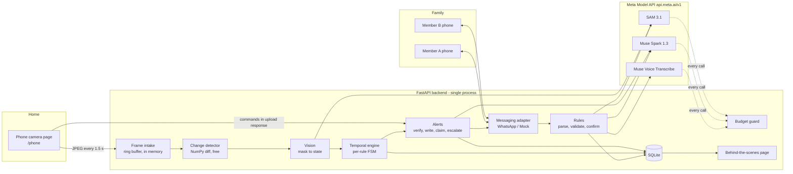
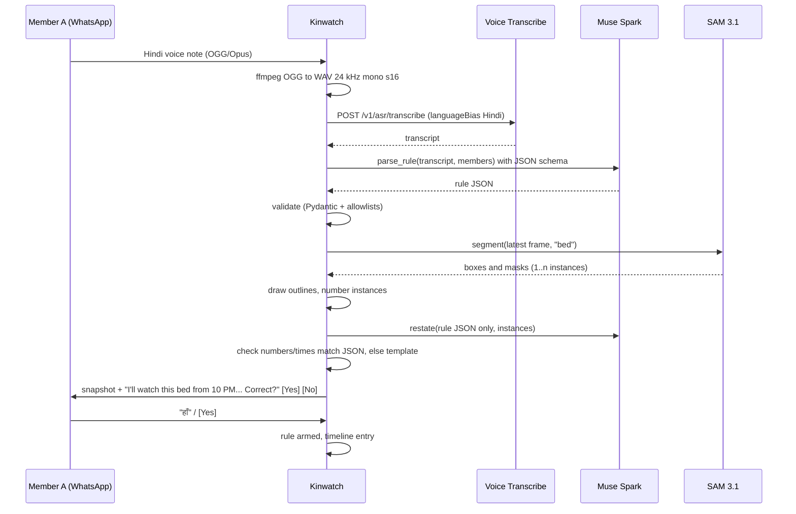
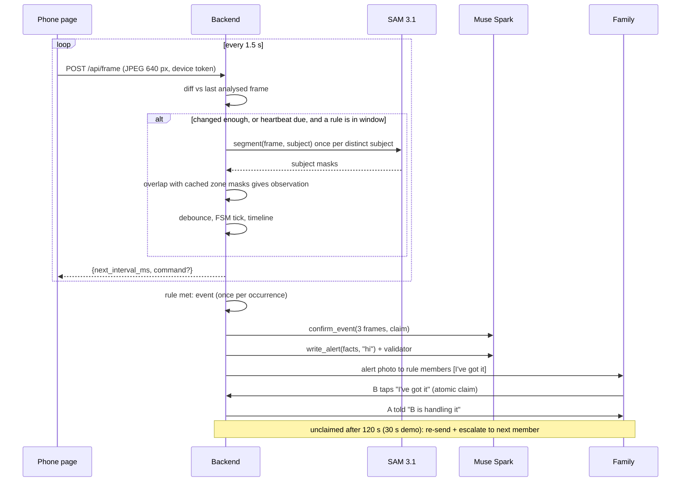
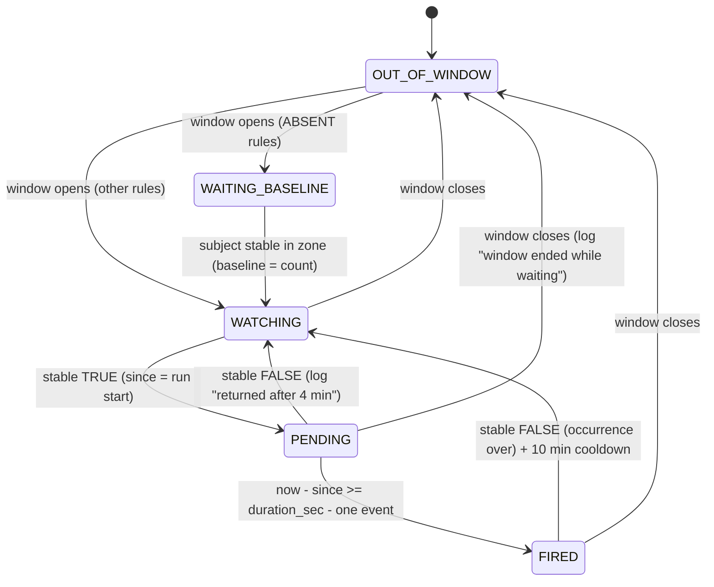

# Kinwatch: Build Plan

> Status: draft for review, written Mon 26 Oct 2026 (kickoff day), IST.
> After approval, this file is saved as `PLAN.md` in the project root. No application code until you say "start building."
> All times are **Asia/Kolkata (IST)** unless marked ET.

---

## 0. Context

Kinwatch is a solo entry for the Meta Global AI Developer Hackathon (Indie track, theme "Build for Your World"). It turns any phone with a browser into a camera that a family programs by **talking to it in WhatsApp**, in Hindi, Kannada or English. Meta's models compile each sentence into a rule, show the family what will be watched, watch over time, and send alerts that the family claims together.

**Decisions from your answers (26 Oct):**

| Topic | Decision |
|---|---|
| Main scenario language | Hindi voice note in, Hindi confirmation and alert out |
| Second language | Kannada for the light scenario (typed). English for the stove scenario (typed) |
| Props | Gas stove with visible flame: yes. Dog or toy dog: **no**. The light scenario is the **Kannada "tell me when Appa comes back to the main door"** rule (`PRESENT_IN_ZONE`) |
| Family phones | 2+ other people's phones: yes. **A = `<NAME 1>`** (sends the rule), **B = `<NAME 2>`**. **Escalation order: A, then B.** Message examples below use "Priya" (A) and "Rahul" (B) as sample names; seed data and fixtures use the real names, which live only in `.env`, never in the repo |
| Scope cuts (27 Oct review) | No GitHub Pages static export; no replay recomputation test; no AI reply classifier; no 60 s re-check in event verification |
| Fixtures rule | Fixtures committed to the repo are recorded **from Tue 27 Oct onward**. Step 0 outputs stay in `scratch/` only |
| Messaging (27 Oct, updated afternoon) | **Telegram is the working channel for now; WhatsApp is built and blocked by Meta.** Once our app was subscribed to the WABA, status webhooks showed every outbound message failing with **131031 "Business Account locked"**. The health-status API gave the reasons: payment method error (141006), business profile incomplete (131000), business not verified (141010); WhatsApp Manager says "verify your business in Security Centre" before any messaging. Verification can take days, so the Telegram adapter (§6.2) was built the same day and the full voice-note → rule → confirm → armed flow works on Telegram. If verification clears before filming, `MESSENGER=whatsapp` switches back; the video shows whichever channel works live (§8 Plan B) |
| Phone numbers | Live **only in `.env` and the SQLite database**, never in the repo, fixtures, logs or screenshots committed to git. Fixtures use placeholders like `<A_WA_ID>` |
| Camera device | No spare old phone. Dev: laptop webcam in Chrome. Filming: your own Android phone as the camera (or borrow an old phone from a relative if one turns up) |
| Papa | You play Papa yourself. The video says it is a re-enactment |
| Hosting | **No paid hosting.** Development and demo filming run on your laptop with **Cloudflare Tunnel**. The judges' live link is a **replay-only build** (no live API calls) on a free Python host that may sleep and take a moment to wake. The README keeps full local run instructions. See §12 |

**Test calls:** all 10 used (§7.4, 26–27 Oct). Auth, Spark structured output in Hindi, Spark multi-image vision, SAM on person / sofa / flame / dim light / door, and Voice Transcribe all work. Four design changes came out of them (§7.4). §7.1 comes from Meta's official docs, which I read on 26 Oct.

**`.env`:** the folder was empty when I first looked; you've since opened `kinwatch\.env`. I will never read or print it; the scripts only check that `META_API_KEY` is set.

---

## 1. Product summary and rubric strategy

**One-liner:** Kinwatch is a family member with eyes that lives in your WhatsApp. Tell it what to watch in your own words or a voice note, see exactly what it understood, and when something happens, your family responds together.

**Honest positioning:** natural-language camera rules already exist (Nurby, Cognitive Companion, Alaro). Kinwatch never claims to be first. What sets it apart is its shape: no setup on any phone, the family chat as the whole interface, a visual confirmation of every rule, and family claim and escalation. No code is taken from those projects.

**Framing guardrail:** Kinwatch watches **presence and routines, not health**. It reports what the camera saw and when, and nothing else. There is no fall detection, no "he seems unwell," and no advice. This keeps it clear of the "medical advice" anti-project. It is also not a "simple image analyzer," because the core is a temporal engine plus a family coordination loop.

### How each part scores

| Criterion (weight) | What earns points | Where it shows |
|---|---|---|
| **Impact (30%)** | Real problem in Indian families (parents living alone, children in other cities). No app install, no hardware, works in the chat app families already use, works in Hindi and Kannada voice notes. Family claim and escalation answer "who is handling it?", which single-recipient alerts don't. | Video 0:00–0:35, README "Problem" |
| **Use of Meta AI tooling (25%)** | Three Meta models chained, each doing something a basic integration wouldn't. **Muse Voice Transcribe:** Hindi and Kannada voice notes with code-switching (plus check-in answers in the stretch goal). **Muse Spark:** (a) compiles a sentence into a rule JSON using schema-constrained output, (b) resolves "no, the other bed" against a numbered SAM snapshot, (c) checks the event against several frames, (d) writes the alert in the family's language. **SAM 3.1:** concept segmentation used as geometry (mask overlap gives the state), multi-instance numbering for disambiguation, and a stretch goal of video tracking on the alert clip. | Behind-the-scenes page, video 2:30 |
| **Technical depth (20%)** | Deterministic temporal engine (no AI deciding timing) with debouncing, midnight-crossing windows and occurrence tracking. Mock and real adapters, with replay tests on recorded frames and a fake clock. Budget module with hard caps and a reserve kept for alerts. Atomic claim handling. Verified webhooks. Model output is always validated, with template fallbacks. The design is "verifiable agent" style: every decision is logged with its evidence. | Tests, README architecture, timeline |
| **Demo (25%)** | Works live on real phones. One engine, three scenarios, no code changes between them. Shows the "here's what I understood" outline moment and two phones claiming. The live link is a **replay demo**: a real recorded session played back from its stored results, with no API calls and no cost, so it can't break or burn credits during judging. | Video, live link |

---

## 2. Architecture



### Flow 1: Setting a rule (once per rule)



If the reply is "no, the other bed" or just "2": number fast path, otherwise Muse Spark `resolve_correction`. The snapshot is re-sent with only the chosen instance outlined.

### Flow 2: Watching (every frame)



**Process model:** one Uvicorn worker, asyncio. Frames live in an in-memory ring buffer (last ~40 frames, about 60 s) and are discarded after that. Engine state is snapshotted to SQLite every 10 s and on every transition, so a restart resumes timers. Background tasks: the escalation scheduler (5 s tick) and the confirmation-timeout sweeper (60 s tick).

---

## 3. Module-by-module design

Layout (the one you suggested, with a few additions marked +):

```
kinwatch/
  phone/index.html               camera page (served at /phone, same origin)
  backend/main.py                FastAPI app, routes, startup tasks
  backend/config.py              pydantic-settings from .env
  backend/schemas.py        +    Pydantic models: Rule, Instance, Observation, Event, ...
  backend/clock.py          +    Clock protocol (real IST clock / fake clock for replay)
  backend/prompts/          +    prompt text files (versioned, loaded at startup)
  backend/models/base.py         adapter protocols
  backend/models/meta_*.py       real adapters (spark, sam, transcribe)
  backend/models/mock_*.py       mock adapters (fixtures)
  backend/rules.py               parse, validate, confirmation conversation
  backend/vision.py              change detection, SAM calls, mask-to-state
  backend/engine.py              debouncer, per-rule FSM, events
  backend/alerts.py              verify, write, claim, escalate
  backend/checkin.py        +    stretch: ask-the-person-first
  backend/messaging/base.py      Messenger protocol, Inbound/Button types
  backend/messaging/whatsapp.py  WhatsApp Cloud API
  backend/messaging/mock.py  +   in-memory outbox + /dev/chat simulator page
  backend/router.py         +    inbound message routing by conversation state
  backend/budget.py              counting, caps, cost, circuit breaker
  backend/storage.py             sqlite3 access (no ORM), migrations
  backend/media.py          +    ffmpeg wrappers (audio to WAV, frames to MP4), drawing
  web/behind_the_scenes/         judges' page (HTML + JS polling JSON endpoints)
  scripts/                  +    dev_up.py (tunnel + webhooks), record_session.py, replay.py (engine replay tests), seed.py
  tests/                         unit + replay tests
  fixtures/                      recorded frames, API responses, transcripts; sessions/ for replay mode
  scratch/                       throwaway API experiments (gitignored)
  render.yaml               +    replay-only deploy config (MODE=replay, no secrets)
  .env.example, README.md, LICENSE, requirements.txt
```

**Dependencies:** `fastapi`, `uvicorn[standard]`, `pydantic>=2`, `pydantic-settings`, `openai>=1.0` (AsyncOpenAI with base_url), `httpx`, `meta_sam_parser` (official SAM output parser, ≥0.0.6, latest 0.1.0), `numpy`, `pillow`, `python-multipart`, `tzdata` (**required on Windows** for `zoneinfo("Asia/Kolkata")`), `pytest`, `pytest-asyncio`. System: `ffmpeg` (`winget install ffmpeg` locally, `apt` in Docker). Python 3.11+.

### 3.1 Phone camera page (`phone/index.html`)

- **Start screen:** one big "Start watching" button. The tap is a user gesture, which unlocks audio playback for the check-in and requests camera (and, if check-in is enabled, mic) permission. The device token comes from the URL `?d=<token>` and is stored in localStorage (wrapped in try/catch).
- **Camera:** `getUserMedia({video:{facingMode:"environment", width:{ideal:1280}}})`. Draw to a canvas 640 px wide (keep aspect ratio), `toBlob('image/jpeg', 0.7)` gives ~40–70 KB.
- **Upload loop:** `fetch POST /api/frame` with body = JPEG and headers `X-Device-Token`, `X-Captured-At` (ms epoch). Interval comes from the server (`next_interval_ms`, default 1500). One request in flight at a time; if the previous request hasn't returned, skip this tick ("latest frame wins").
- **Commands without SSE:** the upload response carries `{"command": {"type":"checkin", "id":..., "say":"...", "lang":"hi-IN", "listen_sec":20}}` or `null`. That removes the need for a second channel, and frames already arrive every 1.5 s.
- **Wake lock:** `navigator.wakeLock.request('screen')` (Chrome 84+), re-acquired on `visibilitychange`. Fallback for older Chrome: a muted, looping, inline 1×1 video, the NoSleep technique (own small implementation, no copied code).
- **Resilience:** network errors give exponential backoff 1.5 s → 3 → 6 → 12 → max 30 s with jitter, plus "Offline, retrying" status. `track.onended` or camera errors trigger a re-acquire attempt every 10 s. Orientation: read `video.videoWidth/Height` each capture, so rotation just changes the frame shape. The backend treats a large shape change as "camera moved" and refreshes zone masks.
- **Status chip:** green "Watching" / amber "Retrying" / red "Camera blocked". Shows the last upload time and the number of armed rules. Bilingual labels (English + Hindi).
- **Permission errors:** clear instructions ("Tap the lock icon in the address bar, then Camera, then Allow").
- **Dim screen:** an optional black overlay with a tiny status dot so the screen doesn't light up the room at night (wake lock still holds).

### 3.2 Rule parser (`rules.py` + `models/meta_spark.py`)

- **Input:** text (typed) or transcript (voice), the sender, and the household member list.
- **Call:** Muse Spark `muse-spark-1.3`, Chat Completions, `response_format={"type":"json_schema","json_schema":{"name":"kinwatch_rule","schema":RULE_LLM_SCHEMA}}` (shape confirmed in the cookbook; schema must use `additionalProperties:false` with every field required; no recursive `$ref`). Low reasoning effort (parameter name to VERIFY).
- **Validation (code, after the model):**
  1. Pydantic parse (constrained decoding should guarantee this; still checked).
  2. `subject` in `SUBJECT_VOCAB`; `zone_object` non-empty, ≤4 words, no commas or "and" (SAM accepts **one concept per request**, and comma lists return zero matches).
  3. `condition` in the 4 enums; the guard is only allowed with `NO_PERSON_NEAR`.
  4. `duration_sec` 0–43,200; ABSENT and NO_PERSON_NEAR default to 300 if 0. The default is visible in the restatement, which the family confirms.
  5. `time_window` HH:MM valid; start ≠ end.
  6. `notify` names resolved against members (case- and diacritic-insensitive); unknown name means a clarification question.
  7. Medical or health terms in the original text with `status != unsupported` force `unsupported` (belt and braces).
- **Outcomes:** `ok` gives a confirmation snapshot (§3.3). `needs_clarification` sends the model's question back and keeps the conversation state `awaiting_clarification` for 10 min; the reply is appended to the original text and re-parsed (max 2 rounds). `unsupported` sends a polite explanation plus suggested alternatives.
- **Voice notes:** download media, run ffmpeg `-ac 1 -ar 24000 -c:a pcm_s16le` to WAV, then `POST /v1/asr/transcribe` (multipart `request` JSON + `audio` file, `languageBias: ["Hindi","Kannada","English"]`). Kinwatch replies first with "मैंने सुना: «transcript»", so a wrong transcript is visible right away.

### 3.3 Confirmation snapshot (`rules.py`, `vision.py`, `media.py`)

1. Take the latest frame from the ring buffer. If none is fresher than 10 s, reply "The camera isn't connected right now" and keep the rule as draft.
2. One SAM call with `zone_object` (e.g. `"bed"`), plus one SAM call for the subject if it's visible (e.g. `"person"`) so it can also be outlined in a second colour. That is 1–2 SAM calls, $0.005 at most.
3. Draw with Pillow: zone instances as thick green outlines (mask contour via mask XOR eroded mask) with big numbered badges "1", "2"; subject in blue.
4. 0 instances: "I can't see a bed in the camera view. Point the phone at it, or tell me what it looks like." Rule stays draft.
   2+ instances: the restatement asks "Which one: 1 or 2?"
5. Restatement (§5.2) is written **from the validated JSON only, never from the original text**, so the family confirms exactly what will run. A validator checks that every number and time in the restatement appears in the JSON; otherwise the per-language template is used.
6. Send the image + restatement + buttons [Yes ✓] [No ✗].
7. **Replies:** yes (button, or "haan/हाँ/ಹೌದು/yes/ok/sahi") arms the rule, stores the zone masks + the reference frame, and logs to the timeline.
   A number ("2") selects that instance.
   "No, the other bed" / "the one near the window" goes to Muse Spark `resolve_correction`, which sees the numbered snapshot + instance descriptors (left/right/top/bottom, size rank computed by us) and returns `{action: select_instance|reparse|cancel, instance, new_text}`.
   Plain "no" gets "What should I change?"
8. **Timeouts:** reminder after 10 min; draft discarded after 60 min ("I didn't arm it").

### 3.4 Vision loop (`vision.py`)

- **Change detection (free):** grayscale, downscale to 160×120, absolute difference against the last frame that was analysed. `changed = mean_abs_diff > 6 or frac(|diff| > 25) > 0.02` (tuned on recorded frames). Mean luminance under 25/255 marks the frame `dark`.
- **When to call SAM, per distinct subject among in-window armed rules:**
  - frame changed, and ≥2 s since the last call for that subject; or
  - heartbeat: 30 s since the last call (10 s while any rule using it is `PENDING`, because the moment of return matters); `flame` uses a 30 s heartbeat only (slow-changing).
  - Never if no armed rule is in its time window. That is the biggest saving: nothing runs outside 22:00–06:00 for the Papa rule.
- **Zone masks:** cached from the confirmation step. Refreshed with one SAM call when (a) the camera moved (whole-frame structural diff against the reference frame > threshold while no subject is detected), (b) every 20 min while armed, or (c) frame shape changed.
- **Mask to state (geometry in NumPy):**
  - **Zone masks are column-filled first:** for each column, fill from the mask's top pixel to its bottom pixel. SAM leaves out the parts of the zone hidden behind the person lying on it (test calls 4–5: the raw sofa mask overlaps the lying person 0.00, and dilated by 8 px only 0.16), so without this a person in bed would read as "not in bed." Column-filled: 1.00.
  - `overlap(S, Z) = |S ∩ dilate(colfill(Z), 8px)| / |S|`.
  - **in zone:** overlap ≥ 0.30. **on object:** overlap ≥ 0.5 **and** the bottom 25% rows of S's box fall inside Z's filled, dilated mask.
  - **Doors:** SAM's "main door" is the door leaf, not the doorway (test call 8: the open door panel was outlined and the person standing in the doorway was beside it). For a door zone, PRESENT_IN_ZONE uses the **near** test below instead of overlap.
  - **near (NO_PERSON_NEAR):** any person box intersects Z's box expanded by 0.75 × Z width; in a kitchen-framed shot this effectively means "anyone in view."
  - **Counts:** number of S instances in zone. That handles two people: `ABSENT_FROM_ZONE` triggers when the count in zone drops **below the baseline count** seen in the window (Mummy stays, Papa leaves: count goes 2 → 1, which still triggers). The restatement says honestly "I can't tell people apart; I watch how many people are in the bed."
  - **Guard** (e.g. flame present on stove): evaluated from its own SAM subject call.
- **Unknowns:** a SAM error, budget refusal, `dark`, or a missing frame gives `Observation.UNKNOWN`, never a TRUE or FALSE guess.
- **Confidence:** request `include_confidence:"true"` and drop instances with c < 0.35 (tuned in Step 0).
- **Low light:** if dark persists for 3 min during a window, send one notice per night to the rule creator: "It's too dark for me to see the bed. A small lamp helps." Never repeated.
- **Latency:** SAM calls go through an asyncio worker with a per-subject queue of size 1 (latest frame wins). If SAM is slower than the frame rate, stale frames are dropped, not queued.

### 3.5 Temporal engine (`engine.py`): plain Python, no AI

**Observation per rule per analysed frame:** `TRUE` = the condition holds right now, `FALSE`, or `UNKNOWN`.

| Condition | TRUE when |
|---|---|
| PRESENT_IN_ZONE | count(S in Z) ≥ 1 |
| ABSENT_FROM_ZONE | baseline established **and** count(S in Z) < baseline |
| ON_OBJECT | any S on Z |
| NO_PERSON_NEAR | no person near Z **and** (no guard, or the guard holds) |

**Debouncer (per rule):** the stable value flips only after **K = 3 consecutive** agreeing observations spanning ≥ 4 s. UNKNOWN neither confirms nor breaks a run. When a flip to TRUE is accepted, `true_since` is **backdated** to the first observation of the run, so debouncing doesn't add delay to the timer. One bad frame can never trigger or reset a rule.



- `duration_sec = 0` means fire on the stable flip itself.
- **One event per occurrence:** FIRED doesn't re-fire until the condition has been stably FALSE (the occurrence ended), plus a 10-minute cooldown.
- **Time windows in IST, crossing midnight:** `in_window(t, s, e) = s <= t < e if s < e else (t >= s or t < e)`. A `null` window means always.
- **UNKNOWN while PENDING:** the timer keeps running; if more than 50% of the pending period was UNKNOWN, the event facts get `visibility: "poor"` and the alert says "I couldn't see clearly for part of this time."
- **DEMO_MODE:** `TIME_SCALE=20` divides `duration_sec` (10 min becomes 30 s) and sets the claim timeout to 30 s. Both are shown on the behind-the-scenes page and as a caption in the video. Optional `DEMO_CLOCK_OFFSET` to fake "night" (not needed if filming at night).
- **Timeline entries** are written on every stable flip and transition, e.g. `22:01 Papa in bed (1 person)`, `02:03 bed count 1 → 0`, `02:13 not back for 10 min — rule met`, `02:13 alert sent to Priya, Rahul`, `02:14 Rahul is handling it`.
- **Clock injection:** all `now()` calls go through `Clock`, so replay tests run a night in milliseconds.

### 3.6 Event check and message (`alerts.py`)

1. **Evidence:** 3 frames from the ring buffer plus pending-start snapshots: (a) the frame at `since` (kept when PENDING began), (b) the midpoint, (c) now. The clip is the last ~20 buffered frames, run through ffmpeg as H.264 `yuv420p` MP4 at 4 fps (≈5 s), stored under `data/events/<id>/`.
2. **Verification (once, advisory only):** Muse Spark `confirm_event` with 3 images + per-frame claims, structured output `{consistent: bool, visible_summary: str, confidence: low|medium|high}`. **One call, no re-check. It never suppresses an alert** (changed 27 Oct after test call 3, where Spark described the frames correctly but answered `consistent: false` with high confidence because the claim's wording overlapped at the boundary time). The verdict and `visible_summary` are stored on the event and shown on the behind-the-scenes page; an inconsistent verdict is logged for tuning. Error, timeout or budget refusal: send anyway with no claim of verification.
   - **Claim wording:** one factual statement per frame, never a time range that touches another frame ("Frame 1 (02:03): a person is on the bed. Frame 2 (02:08): no person is on the bed. Frame 3 (02:13): no person is on the bed.").
3. **Writing:** Muse Spark `write_alert(facts, language)` from structured facts only. Validator: must contain the start time string; ≤ 300 chars; no banned terms (medical, diagnostic or emotional-interpretation words in en/hi/kn, list in `prompts/banned_terms.txt`); else the per-language template. **Messages only state what was seen and when.**
4. Hand over to claim and escalation (§3.8).

### 3.7 Messaging (`messaging/`)

```python
class Messenger(Protocol):
    channel: Literal["whatsapp", "mock"]  # a second channel would add a value here
    async def send_text(self, to: Member, text: str, buttons: list[Button] | None = None) -> SentRef: ...
    async def send_image(self, to: Member, jpeg: bytes, caption: str, buttons: list[Button] | None = None) -> SentRef: ...
    async def send_video(self, to: Member, mp4: bytes, caption: str) -> SentRef: ...
    async def send_alert(self, to: Member, text: str, jpeg: bytes, alert_id: int) -> SentRef: ...  # template-aware
    def verify_and_parse(self, headers: Mapping[str, str], raw_body: bytes) -> list[Inbound]: ...  # raises on bad signature
    async def download_media(self, ref: str) -> tuple[bytes, str]: ...
```

`Inbound = {provider_msg_id, channel, sender_address, kind: text|voice|button, text, button_payload, media_ref, ts}`. `MESSENGER=mock|whatsapp` in `.env`. Each member row stores its channel, so a second channel could be added later without touching the core. Full design in §6.

### 3.8 Claim and escalation (`alerts.py`)

- **Alert rows** have `status open|claimed|expired`, `escalation_level`, `next_escalation_at`.
- **Claim:** `UPDATE alerts SET claimed_by=?, claimed_at=?, status='claimed' WHERE id=? AND status='open'`. `rowcount == 1` wins. SQLite serialises writers, so two simultaneous "I've got it" replies cannot both win. The loser gets "Rahul is already handling it."
- **Recognition (no AI):** button payload `claim:<alert_id>` (exact), or text keywords ("I've got it", "got it", "मैं देख लेता हूँ / लेती हूँ", "main dekh leta", "ನಾನು ನೋಡ್ತೀನಿ") applied to the member's latest open alert. Anything else while an alert is open gets the fallback reply (§5.6).
- **On claim:** the claimer gets "Thanks, I've told the others." Everyone else who received the alert gets "Rahul is handling it (02:14)." Logged to the timeline.
- **Escalation:** the scheduler checks `next_escalation_at`. Level 1 is a re-send to the rule's notify list ("Still unclaimed after 2 min"). Level 2 sends to the next member in the household `escalation_order` not yet alerted. Then it repeats re-sends every timeout up to 3 levels; after that, `expired` with a final "Nobody has claimed this alert" to all. The timeout is 120 s (30 s in DEMO_MODE).
- **Persistence:** escalation deadlines are stored in SQLite, so a restart doesn't lose them.

### 3.9 Check-in (P1, `checkin.py`): built Sat 31 Oct, go/no-go Sun 1 Nov evening

- **On event (before verification and alert):** if the household enables check-in and the phone page is online, queue the command `{say, lang:"hi-IN", listen_sec:20}`.
- **Speaking:** browser `speechSynthesis` with a `hi-IN` voice if available. **Fallback:** play a pre-recorded MP3 of a family member's voice ("पापा, आप ठीक हैं? ठीक हैं तो 'हाँ' बोलिए"). This is more reliable on old phones and warmer.
- **Listening:** `MediaRecorder` records 20 s (webm/opus on Chrome Android) and uploads it to `/api/checkin/<id>`. ffmpeg converts it to WAV, then **Muse Voice Transcribe** produces the transcript, then a keyword or Spark yes/no check. The answer is understood by a Meta model, not by `webkitSpeechRecognition` (which depends on Google servers and is inconsistent on old Android).
- **Result:** "yes" cancels the alert and logs "Papa said he's fine." "No" or silence sends the alert, with the facts plus `check_in: "no response"` or `"answered: <transcript>"`. Total delay is capped at 35 s.
- **Unsupported** (no mic permission, MediaRecorder missing): skip check-in silently and log it.

### 3.10 Behind-the-scenes page (`web/behind_the_scenes/`)

Read-only page served at `/bts?t=<token>` (the token is exchanged for a cookie). It polls JSON every 2 s:
- **latest frame** with zone outlines (green) and subject outlines (blue), plus a per-rule state badge;
- **sentence → transcript → rule JSON** side by side for each rule, with schema validation shown as passing;
- **live timeline** (last 50 entries);
- **API budget:** calls per model, last hour and total, estimated $, caps, and a mode badge **LIVE / MOCK / REPLAY**;
- **demo mode indicator** ("Time ×20").

**Replay demo mode (`MODE=replay`, the judges' live link):**
- **Recorded session** = `fixtures/sessions/<name>/`:
  - `manifest.json`: household with placeholder names and no phone numbers, rule sentences, transcripts, rule JSON;
  - `frames/*.jpg` with capture timestamps;
  - `responses/`: every recorded SAM / Spark / ASR result for those frames;
  - `messages.jsonl`: inbound and outbound chat messages with timestamps;
  - `cost.json`: the actual spend of the recorded run.
- **Capture:** `scripts/record_session.py` captures a session from a real live run on the laptop. It wraps the live adapters with `RECORD_FIXTURES=true` and taps the messenger.
- **Playback:** the replay server plays the recorded session **directly from its stored results**: frames, rule JSON, SAM outlines, timeline entries and chat messages, all on their recorded timestamps. Replay mode doesn't run the engine. The engine is exercised separately by the replay tests in §10.
- **Page extras in replay mode:**
  - a play / pause / speed control (1×, 5×, 20×) and a scrubber over the session;
  - a "family chat" panel styled as a neutral chat (not imitating WhatsApp's branding) showing the confirmation snapshot, the "yes," the alert and the claim exchange as they happen;
  - a banner: "Replay of a recorded session from <date>. No live API calls. Run the full version locally: see README."
- **Hard guarantee:** in `MODE=replay` the real adapters are never constructed. The app refuses to start if `META_API_KEY` is set, so the key can never be deployed by mistake. Webhooks, the phone page and frame upload routes are not mounted.
- **Sessions to record:** `night_bed` (main, Hindi), `stove` (English), `kannada_door`. A session picker sits on the page.

### 3.11 Budget module (`budget.py`)

- **`async with budget.guard(model, purpose, est_units)`** is called before every real API call. It raises `BudgetExceeded` if any cap would be exceeded and records actual usage afterwards (tokens from `usage`, images, audio seconds).
- **Prices** (from Meta's pricing page, 26 Oct):

  | Model | Price |
  |---|---|
  | Spark Standard | $1.25 / M input, $0.15 / M cached input, $4.25 / M output (reasoning tokens count as output) |
  | SAM 3.1 | $2.50 / 1k images; video $0.20 / 1k frames, min 50 frames per request |
  | Voice Transcribe | $0.18 / hour |

- **Default caps (`.env`):**

  | Setting | Default |
  |---|---|
  | `BUDGET_TOTAL_USD` | 20 |
  | `BUDGET_DAILY_USD` | 4 |
  | `SAM_MAX_PER_HOUR` | 300 |
  | `SAM_MAX_PER_MIN` | 20 |
  | `SPARK_MAX_PER_HOUR` | 120 |
  | `ASR_MAX_SEC_PER_DAY` | 1800 |
  | `ALERT_RESERVE_USD` | 1.00 |

  Vision calls cannot consume the last $1; that is kept for verification and writing.
- **Circuit breaker:** 5 consecutive errors from a model pause it for 5 min. No retry on 4xx. 429/5xx get at most 2 retries with jittered backoff (0.5 s, 1.5 s). There is never an unbounded loop.
- **Kill switch:** the file `data/STOP_LIVE` (or `USE_MOCKS=true`) makes every real adapter refuse immediately.
- **`/api/budget`** feeds the page; the totals are persisted in `api_calls`.
- **Note:** the Meta billing dashboard is the source of truth. Our estimate is cross-checked by hand daily (§9).

### 3.12 Storage (`storage.py`)

Plain `sqlite3`, WAL mode, a single connection with an asyncio lock (writes are tiny), and numbered migration SQL files.

---

## 4. Data schemas

### 4.1 Rule JSON: what Muse Spark returns (`RULE_LLM_SCHEMA`)

All fields are required with `additionalProperties:false` (a constrained-decoding requirement). Whether nullable unions (`["string","null"]`) are accepted is a **VERIFY (test call 2)**. If not, use sentinels: `""`, `-1`, `"none"`.

```json
{
  "type": "object",
  "additionalProperties": false,
  "required": ["status", "clarifying_question", "subject", "subject_name", "zone_object",
               "condition", "duration_sec", "time_window", "guard", "notify", "language"],
  "properties": {
    "status": {"type": "string", "enum": ["ok", "needs_clarification", "unsupported"]},
    "clarifying_question": {"type": ["string", "null"]},
    "subject": {"type": "string", "enum": ["person", "dog", "cat", "flame", "none"]},
    "subject_name": {"type": ["string", "null"]},
    "zone_object": {"type": ["string", "null"]},
    "condition": {"type": "string",
                  "enum": ["PRESENT_IN_ZONE", "ABSENT_FROM_ZONE", "ON_OBJECT", "NO_PERSON_NEAR", "none"]},
    "duration_sec": {"type": "integer", "minimum": 0, "maximum": 43200},
    "time_window": {
      "type": ["object", "null"], "additionalProperties": false,
      "required": ["start", "end"],
      "properties": {
        "start": {"type": "string", "pattern": "^([01][0-9]|2[0-3]):[0-5][0-9]$"},
        "end":   {"type": "string", "pattern": "^([01][0-9]|2[0-3]):[0-5][0-9]$"}
      }
    },
    "guard": {
      "type": ["object", "null"], "additionalProperties": false,
      "required": ["subject", "zone_object"],
      "properties": {
        "subject": {"type": "string", "enum": ["flame", "person", "dog", "cat"]},
        "zone_object": {"type": "string"}
      }
    },
    "notify": {"type": "array", "items": {"type": "string"}, "minItems": 1, "maxItems": 5},
    "language": {"type": "string", "enum": ["hi", "kn", "en"]}
  }
}
```

`guard` is the one addition to your field list. "The stove is on **and** nobody's in the kitchen" needs two facts: `condition: NO_PERSON_NEAR` on `gas stove` with `guard: {subject: flame, zone_object: gas stove}`. Without it, the stove scenario can't be expressed. `SUBJECT_VOCAB` lives in config; a fridge fallback may add a subject (decided by test call 6, see §11).

### 4.2 Stored rule (Pydantic `Rule`)

The above plus `id`, `household_id`, `created_by` (member id), `original_text`, `input_kind` (text|voice), `transcript`, `zone_instance` (selected index), `zone_masks_ref`, `reference_frame_ref`, `status` (draft|awaiting_confirmation|armed|paused|deleted), `restatement`, `created_at`, `armed_at`, `schema_version: 1`.

### 4.3 State memory (`rule_state.state_json`)

```json
{"phase": "PENDING", "stable": true, "run": {"value": true, "count": 3, "first_ts": 1793223780.1},
 "true_since": 1793223780.1, "baseline_count": 1, "last_obs": "TRUE", "unknown_sec_in_pending": 12,
 "last_event_id": null, "cooldown_until": null, "last_sam_ts": {"person": 1793223801.0}}
```

### 4.4 Event facts (input to verification and alert writing)

```json
{"rule_id": 3, "subject_name": "Papa", "subject": "person", "zone_object": "bed",
 "condition": "ABSENT_FROM_ZONE", "what": "left the bed and has not come back",
 "started_at_local": "02:03", "met_at_local": "02:13", "duration_min": 10,
 "visibility": "good", "check_in": null, "language": "hi"}
```

### 4.5 SQLite tables

| Table | Key columns |
|---|---|
| `households` | id, name, default_language, demo_mode, checkin_enabled |
| `members` | id, household_id, name, channel, address (wa_id / chat_id), escalation_order, last_inbound_at (WhatsApp 24 h window), is_admin |
| `devices` | id, household_id, name, token_hash (sha256), last_seen_at, last_frame_shape |
| `rules` | id, household_id, created_by, original_text, input_kind, transcript, rule_json, zone_instance, restatement, status, created_at, armed_at |
| `rule_state` | rule_id PK, state_json, updated_at |
| `conversations` | member_id PK, state (idle / awaiting_confirmation / awaiting_clarification / awaiting_instance), rule_id, expires_at, data_json |
| `events` | id, rule_id, started_at, met_at, facts_json, verification_json, status (sent / suppressed / unverified_sent / cancelled_by_checkin), snapshot_path, clip_path |
| `alerts` | id, event_id, text, language, status, claimed_by, claimed_at, escalation_level, next_escalation_at |
| `deliveries` | id, alert_id NULL, member_id, kind (confirm / alert / resend / escalation / claim_notice / info), provider_msg_id, sent_at, status, error |
| `inbound_messages` | provider_msg_id PK (dedupe webhook retries), channel, member_id, kind, body, received_at, processed_at |
| `timeline` | id, household_id, ts, rule_id NULL, kind, text, data_json |
| `api_calls` | id, ts, model, purpose, input_tokens, output_tokens, images, audio_sec, est_cost_usd, latency_ms, ok, error_code, mode (live / mock) |

---

## 5. Muse Spark prompts

All prompts live in `backend/prompts/*.md`, versioned and loaded at startup. Images are only sent in `user` messages (a `system` or `developer` message with an image returns 400, per the cookbook). Persona: Kinwatch speaks in the first person; Hindi uses masculine verb forms ("रखूँगा"). This is a persona choice you can change (§16).

> Note: all Hindi and Kannada text below was written by me and should be **checked by a native speaker** before filming (§16).

### 5.1 Rule parsing (system prompt)

```
You convert one message from a family member into a monitoring rule for Kinwatch, a home camera
assistant. Kinwatch only reports what a camera can see and when. It never gives advice and never
interprets health, illness, medicine, mood or injury.

Return JSON that follows the schema. Field rules:
- condition, exactly one of:
  PRESENT_IN_ZONE  - the subject is at/in the zone object (optionally for at least duration_sec).
  ABSENT_FROM_ZONE - the subject was at/in the zone object and left it, and has not come back for
                     duration_sec ("gets up and doesn't come back", "leaves the bed").
  ON_OBJECT        - the subject is on top of the zone object ("dog on the sofa").
  NO_PERSON_NEAR   - nobody is near the zone object for duration_sec. If something else must also be
                     true (for example "the stove is on"), put it in guard.
- subject: one of person, dog, cat, flame. A named person (Papa, Amma, Dadi, Ajji) is subject
  "person" with subject_name set to the name exactly as written. "Stove is on" means flame.
- zone_object: ONE short visible noun phrase a camera can see: "bed", "sofa", "gas stove",
  "refrigerator", "main door". Never a list. Never a room name if an object fits better
  ("kitchen" -> "gas stove" when the stove is what matters).
- duration_sec: from the message ("10 minutes" -> 600, "aadha ghanta" -> 1800). If none is given,
  use 0 for PRESENT_IN_ZONE and ON_OBJECT, and 300 for ABSENT_FROM_ZONE and NO_PERSON_NEAR.
- time_window: 24-hour HH:MM, India time. "at night"/"raat ko"/"rātri" -> 22:00-06:00.
  "during the day"/"din mein" -> 06:00-22:00. Explicit times win. Nothing said -> null.
- notify: names from HOUSEHOLD exactly as listed. "me", "mujhe", "nanage" -> SENDER.
  "us", "everyone", "sabko", "family", "ellarigu" -> every member. Nothing said -> SENDER only.
- language: the message's language: "hi", "kn" or "en". Hinglish counts as "hi".
- status "unsupported" if the message asks about health, illness, medicine, breathing, falls,
  injury, mood, identity of strangers, or anything these four conditions cannot express. Then
  clarifying_question explains, in the message's language, what Kinwatch can watch and suggests
  the closest supported rule.
- status "needs_clarification" only if something essential is ambiguous (which object, which
  person). Ask ONE short question in the message's language.
- When status is not "ok", set unused fields to null / "none" / 0 / [SENDER].

HOUSEHOLD: {members_csv}
SENDER: {sender_name}
```

**Few-shot examples** (sent as prior user/assistant turns):

1. Hindi (the main scenario, voice transcript).
   Message: `पापा अगर रात को उठें और दस मिनट में वापस न आएँ तो मुझे और राहुल को बताना`
   ```json
   {"status":"ok","clarifying_question":null,"subject":"person","subject_name":"पापा",
    "zone_object":"bed","condition":"ABSENT_FROM_ZONE","duration_sec":600,
    "time_window":{"start":"22:00","end":"06:00"},"guard":null,"notify":["Priya","Rahul"],"language":"hi"}
   ```
2. English (stove).
   Message: `Tell me if the stove is on and nobody's in the kitchen for 5 minutes`
   ```json
   {"status":"ok","clarifying_question":null,"subject":"person","subject_name":null,
    "zone_object":"gas stove","condition":"NO_PERSON_NEAR","duration_sec":300,"time_window":null,
    "guard":{"subject":"flame","zone_object":"gas stove"},"notify":["Priya"],"language":"en"}
   ```
3. Kannada (light scenario: Appa back at the door).
   Message: `ಅಪ್ಪ ವಾಕಿಂಗ್ ಮುಗಿಸಿ ಬಾಗಿಲಿಗೆ ಬಂದ್ರೆ ಹೇಳು` ("tell me when Appa comes back to the door after his walk")
   ```json
   {"status":"ok","clarifying_question":null,"subject":"person","subject_name":"ಅಪ್ಪ","zone_object":"main door",
    "condition":"PRESENT_IN_ZONE","duration_sec":0,"time_window":null,"guard":null,"notify":["Priya"],"language":"kn"}
   ```
   This example also teaches `guard: null` for non-`NO_PERSON_NEAR` rules (test call 2 added a spurious guard).
4. Unsupported.
   Message: `Papa ki tabiyat kharab lage toh batana`
   ```json
   {"status":"unsupported","clarifying_question":"मैं सेहत के बारे में नहीं बता सकता। मैं बस यह देख सकता हूँ कि कैमरे में क्या दिखता है — जैसे पापा रात को बिस्तर से उठें और वापस न आएँ। क्या ऐसा नियम बनाऊँ?",
    "subject":"none","subject_name":null,"zone_object":null,"condition":"none","duration_sec":0,
    "time_window":null,"guard":null,"notify":["Priya"],"language":"hi"}
   ```

### 5.2 Restatement (from JSON only)

```
Write a short confirmation for a family member, in language {language}. Use ONLY the rule JSON
below; do not add, remove or soften anything. Two sentences, then the question "Correct?" in
{language}. Say "this {zone_object}" because the photo shows it outlined. If zone_count > 1, ask
which numbered one instead. Times as spoken in India (10 PM / रात 10 बजे / ರಾತ್ರಿ 10). If
subject is "person", add that you count people and can't tell them apart (one short clause).
RULE: {rule_json}   ZONE_COUNT: {n}   NOTIFY_NAMES: {names}
```

Examples:
- hi: `मैं रात 10 बजे से सुबह 6 बजे तक इस बिस्तर (फ़ोटो में हरे घेरे में) पर नज़र रखूँगा। अगर पापा बिस्तर से उठकर 10 मिनट तक वापस नहीं आते, तो मैं प्रिया और राहुल को बताऊँगा। सही है?`
- en: `I'll watch this gas stove. If the flame is on and nobody is near it for 5 minutes, I'll tell Priya. Correct?`
- kn: `ನಾನು ಈ ಮುಖ್ಯ ಬಾಗಿಲಿನ ಮೇಲೆ ಗಮನ ಇಡುತ್ತೇನೆ. ಬಾಗಿಲ ಬಳಿ ಯಾರಾದರೂ ಬಂದ ತಕ್ಷಣ ಪ್ರಿಯಾಗೆ ತಿಳಿಸುತ್ತೇನೆ — ನಾನು ಜನರನ್ನು ಗುರುತಿಸುವುದಿಲ್ಲ, ಎಣಿಸುತ್ತೇನೆ ಮಾತ್ರ. ಸರಿಯೇ?` (It says honestly that it counts people at the door and can't recognise that it's Appa.)

The validator extracts digits and times (including Devanagari and Kannada numerals) and requires each one to match the JSON. On mismatch, the per-language template is used.

### 5.3 Correction resolver ("no, the other bed")

```
The family member saw a photo where each {zone_object} is outlined and numbered. Instances:
{[{n:1, position:"left", size_rank:1}, {n:2, position:"right, near window", size_rank:2}]}
Their reply: "{reply}". Current choice: {current}.
Return {action: "select_instance"|"reparse"|"cancel", instance: int|null, new_text: str|null}.
"select_instance" if they point to another numbered object. "reparse" if they changed what to watch.
```

The numbered snapshot image is attached in the user message, so Spark can use visual cues ("the one with the blue blanket").

### 5.4 Event confirmation (vision, 3 frames)

```
You check whether three camera frames are consistent with a claimed event. Describe only what is
visible. Do not guess causes, health, feelings or intentions.
Frame 1 at {t1}, frame 2 at {t2}, frame 3 at {t3} (now).
Claim: "{what}" — e.g. "a person was on the bed at 02:03, and from 02:03 to 02:13 no person is on the bed".
Return {consistent: bool, visible_summary: str (max 20 words, English, factual), confidence: "low"|"medium"|"high"}.
```

### 5.5 Alert writing

```
Write a WhatsApp alert in {language} from these facts. One or two short sentences.
State what was seen and when, using the times given. Nothing else: no causes, no health words, no
advice, no reassurance, no emojis except at most one ⚠️ at the start.
If visibility is "poor", add that the camera could not see clearly for part of the time.
If check_in is "no response", add that he/she did not answer the question.
FACTS: {facts_json}
```

Examples (the template fallbacks have the same shape):
- hi: `⚠️ पापा रात 2:03 बजे बिस्तर से उठे और 10 मिनट से वापस नहीं आए हैं। (तस्वीर 2:13 बजे की)`
- en: `⚠️ The gas stove flame has been on since 7:41 PM and nobody has been near it for 5 minutes.`
- kn: `ಸಂಜೆ 6:42ಕ್ಕೆ ಮುಖ್ಯ ಬಾಗಿಲ ಬಳಿ ಒಬ್ಬರು ಕಾಣಿಸಿದರು.` ("Someone appeared at the main door at 6:42 PM." It states what was seen, with no ⚠️ for a light rule; the photo lets the family see it's Appa.)

The claim button label is added by code: `मैं देख लूँगा` / `I've got it` / `ನಾನು ನೋಡ್ತೀನಿ`.

### 5.6 Reply handling: no AI classifier

Inbound messages are routed by **conversation state + buttons, numbers and keywords only** (`router.py`):

| State | Accepted | Action |
|---|---|---|
| idle | any text or voice note | new rule, so `parse_rule` |
| idle | `rules` / `नियम` / `ನಿಯಮ` | list rules |
| idle | `pause N`, `delete N` | pause or delete rule N |
| awaiting_confirmation | [Yes] / yes / haan / हाँ / ಹೌದು / ok / sahi | arm the rule |
| awaiting_confirmation | a digit (`2`) | select instance |
| awaiting_confirmation | starts with no / nahi / नहीं / ಇಲ್ಲ **and** has more words | `resolve_correction` (§5.3) |
| awaiting_confirmation | [No] / bare "no" | "What should I change?" |
| awaiting_clarification | any text or voice | append to the original and re-parse |
| alert open | [I've got it] / claim keywords | claim (§3.8) |

Anything else gets the fallback reply in the member's language:
- en: `Sorry, please tap a button or reply yes/no.`
- hi: `माफ़ कीजिए, कृपया बटन दबाएँ या हाँ/नहीं लिखें।`
- kn: `ಕ್ಷಮಿಸಿ, ದಯವಿಟ್ಟು ಬಟನ್ ಒತ್ತಿ ಅಥವಾ ಹೌದು/ಇಲ್ಲ ಎಂದು ಉತ್ತರಿಸಿ.`

---

## 6. Messaging design

### 6.1 WhatsApp Cloud API (primary and demo channel)

- **Setup (manual, §9):** an app with the WhatsApp product; test number **working since 27 Oct** (`+1 555…`, status CONNECTED, quality GREEN); add up to **5 verified recipient numbers** (each needs an OTP on that phone); get a temporary token, then make a **System User permanent token** (temporary tokens expire in 24 h); App Secret; webhook URL + verify token; subscribe to the `messages` field **and** subscribe our app to the WABA (`POST /{WABA_ID}/subscribed_apps`; on 27 Oct only Meta's "WA DevX Webhook Events 1P App" was subscribed). Graph API **v25.0** (confirmed working 27 Oct).
- **Webhook security:**
  - `GET /webhooks/whatsapp`: check `hub.mode == "subscribe"` and `hub.verify_token == WA_VERIFY_TOKEN`; echo `hub.challenge`.
  - `POST /webhooks/whatsapp`: compute `HMAC-SHA256(app_secret, raw_body)` and compare it in constant time with `X-Hub-Signature-256` (`sha256=...`); reject with 401 otherwise. Return 200 within ~1 s and process in a background task. Dedupe on `messages[].id` in `inbound_messages`. Store every `statuses` event (`sent` / `delivered` / `read` / `failed` + `errors[].code`) on the matching `deliveries` row; a `failed` alert delivery is logged to the timeline and re-sent by the escalation path, and is visible on `/bts`. Ignore senders not in `members`.
- **Inbound types:** `text`; `audio` with `voice: true` (OGG/Opus, fetched by `GET /{media-id}` then a download URL with a Bearer token); `interactive.button_reply.id` (`yes:<rule>`, `no:<rule>`, `claim:<alert>`); `button.payload` for template quick replies.
- **Outbound:** upload JPEG or MP4 to `/{phone-number-id}/media`, then send by media id. Interactive `button` messages (max 3 reply buttons, title ≤20 chars) carry confirmations and claims.
- **24-hour customer service window:** free-form and interactive messages are only allowed within 24 h of the member's last inbound message (`members.last_inbound_at`). Outside it, `send_alert` uses approved templates:
  - `kinwatch_alert` (UTILITY, languages en + hi + kn): header IMAGE, body `Kinwatch alert: {{1}}`, quick-reply button `I've got it` / `मैं देख लूँगा` / `ನಾನು ನೋಡ್ತೀನಿ`.
  - `kinwatch_update` (UTILITY): body `Kinwatch: {{1}}`, used for claim notices and escalations outside the window.
  - Submit both on day one of WhatsApp access; approval can take minutes to a day. Until approved, the fallback is the built-in `hello_world` template plus a follow-up once the member replies (which reopens the window). In the demo video, every member messages Kinwatch shortly before filming, so the window is open. Template rules (no variable at the start or end of the body, ratio of variables to text) may force wording like `Kinwatch alert for your family: {{1}}. Reply here to respond.` VERIFY at submission time.
  - Pricing: utility templates outside the window may be charged per message (India rates) and may need a payment method on the WABA. VERIFY in the dashboard.
- **Delivery debugging (27 Oct):**
  - `scratch/wa_send_test.py` sent one plain-text "Kinwatch test" to your number: **HTTP 200**, `contacts[0].wa_id` matched the input, and a `wamid` came back.
  - That only means Meta **accepted** the message. Delivery is reported later, asynchronously, through `statuses` webhooks (`sent`, then `delivered`, then `read`, or `failed` with an error code). There is no API to look up a message's status by id.
  - Read-only checks: phone number `CONNECTED`, quality `GREEN`, Cloud API. The WABA's only subscribed app is Meta's "WA DevX Webhook Events 1P App" (the dashboard's test webhook), so **our own app is not subscribed and would receive no statuses yet**.
  - To see delivery status we need: (1) our webhook endpoint reachable over HTTPS (cloudflared); (2) the callback URL + verify token in the app's WhatsApp → Configuration, with the `messages` field subscribed (statuses arrive under it); (3) `POST /{WABA_ID}/subscribed_apps` with our token to subscribe our app.
  - **Error codes and fixes:**

    | Code | Meaning | Fix |
    |---|---|---|
    | 131030 | Recipient not in the allowed list | Add the number in API Setup and verify it with an OTP |
    | 131047 | Outside the 24 h window | Send a template, or have the member message first |
    | 131049 | Meta limited marketing delivery for this user | Use utility templates; don't resend |
    | 131026 | Undeliverable | Usually the recipient's WhatsApp is outdated or they haven't accepted the latest terms; update the app, or check that the number is on WhatsApp |
    | 190 | Token expired or invalid | Regenerate the token; System User token for the long term |
    | 130497 | Account restricted from messaging users in that country | Ask in Discord / Meta support |

- **Groups:** the WhatsApp Groups API requires Official Business Account (OBA) status (per 2026 third-party write-ups citing Meta docs; [kapso.ai](https://kapso.ai/blog/whatsapp-groups-api-state-2026), [unipile](https://www.unipile.com/whatsapp-group-api/)). A test number won't have it. **Design: message each member individually and broadcast claim updates.** That's also clearer for "who saw what."

### 6.2 Second channel (not built)

The `Messenger` protocol (§3.7) keeps the core channel-agnostic. A Telegram adapter (Bot API webhook with a secret-token header, `getFile` for voice notes, inline-keyboard buttons) is about half a day of work and is built **only if WhatsApp breaks** (for example the account is restricted or delivery fails and can't be fixed). **Built 27 Oct** after WhatsApp returned 131031: `backend/messaging/telegram.py`, secret-token webhook, inline buttons, voice notes via getFile. Unknown users are told their Telegram ID once so the admin can add it to `FAMILY_MEMBERS_JSON`.

### 6.3 Message catalogue (Hindi household example)

| Moment | Message |
|---|---|
| Voice heard | `मैंने सुना: "पापा अगर रात को उठें…"` |
| Confirmation | photo + §5.2 text + [हाँ ✓] [नहीं ✗] |
| Armed | `✅ नियम चालू। आज रात 10 बजे से नज़र रखूँगा।` |
| Alert | photo + §5.5 text + [मैं देख लूँगा] |
| Claim notice to others | `राहुल इसे देख रहे हैं (2:14)।` |
| Re-send | `⏰ 2 मिनट में किसी ने जवाब नहीं दिया।` + original alert |
| Escalation | `⚠️ प्रिया ने जवाब नहीं दिया, इसलिए आपको भेज रहा हूँ:` + alert |
| Too dark | `कमरे में बहुत अंधेरा है, मुझे बिस्तर नहीं दिख रहा। एक छोटा लैंप जलाने से मदद मिलेगी।` |
| Camera offline (5 min, armed rule in window) | `कैमरा फ़ोन से तस्वीरें नहीं आ रही हैं (2:20 से)।` |

### 6.4 Mock messenger

An in-memory outbox and inbox plus a `/dev/chat` page that simulates members typing, sending a WAV file, or tapping buttons. All of development, the claim race tests and the replay tests run without WhatsApp.

---

## 7. Meta Model API: findings and adapter strategy

### 7.1 Confirmed from official docs (read 26 Oct)

Sources: dev.meta.ai docs (overview, quickstart, models, pricing-rate-limits, SAM overview and segmenting, speech-to-text), cookbook `01_api_fundamentals/04_structured_output` and `07_vision_input`, `07_sam/01_api_basics`, and PyPI `meta-sam-parser`.

| Topic | Finding |
|---|---|
| Base URL and auth | `https://api.meta.ai/v1`, `Authorization: Bearer <key>`. OpenAI-SDK compatible, with Chat Completions, Responses and Messages endpoints (third-party claim **confirmed**). Docs use the env name `MODEL_API_KEY`; we read **`META_API_KEY`** and pass it explicitly to `OpenAI(api_key=...)` |
| Model IDs | `muse-spark-1.3` (also 1.2, 1.1, `-contributor` variants), `sam-3.1`, `muse-voice-transcribe-1.0`, `muse-wonder-1.0` (preview), `muse-image-1.0` |
| Muse Spark endpoints | Responses, Chat Completions, Messages. 1M context. Text, image, video, PDF input ("audio input not fully supported" on 1.3, so voice goes through Voice Transcribe) |
| Structured output | Chat Completions `response_format={"type":"json_schema","json_schema":{"name","schema"}}`; on the Responses API it is `text.format` (sending `response_format` there returns 400). Constrained decoding; needs `additionalProperties:false` and all fields required; recursive `$ref` returns 400. No `strict` flag mentioned |
| Vision | Chat Completions `{"type":"image_url","image_url":{"url":"data:image/jpeg;base64,..."}}`. Multiple images per message, in order (~50 guideline). Images only in `user` messages. jpeg/png/gif/webp. `POST /v1/responses/input_tokens` counts tokens |
| Reasoning effort | Exists on Spark 1.3 (`minimal` to `max`); request parameter name on Chat Completions to **VERIFY** |
| SAM 3.1 request | `POST /v1/responses`, `model:"sam-3.1"`, one user message: `input_text` (short noun phrase) + `input_image` (`image_url`: URL or base64 data URL). `stream: true` is used in the cookbook. `metadata: {include_confidence:"true", mask_encoding:"lossless"|"one_bit"}` |
| SAM concepts | **One concept per request.** Comma, semicolon and plus lists return zero matches; "and" segments only one. Attributes narrow matches. Returns **every matching instance**. No match: empty `output_text` + `response.completed` |
| SAM response | Special-token text in `output_text`: `<0f>0<\|box;x1=..;y1=..;x2=..;y2=..;w=..;h=..\|><\|mask;x=..;y=..;data=...\|>, 1<\|box...` Boxes in source pixels (inclusive). Masks decode to a row-major 0/1 raster |
| SAM parser | Official Python `meta_sam_parser` (0.1.0, 6 Oct 2026, Python ≥3.10, **"SAM License"**): `parse_responses_stream(events, image_segmentation_format())`, `await parsed.final_result()`, `decode_mask_to_raster(mask)` gives `bytes` 0/1, plus `decode_mask_to_rle`, `decode_mask_to_svg_path`. Records have `kind`, `object_id`, `left/top/right/bottom`, `mask.width/height`. The cookbook synthesises a `response.output_text.done` event when the API omits it; we copy that idea, not the code |
| SAM video | `input_video` (MP4/MOV, H.264/H.265/MPEG-4; no WebM/VP9), Files API for reuse, ≤15,000 frames, tracking ≤16 objects, box/point prompts for tracking. $0.20/1k frames, **min 50 frames billed** ($0.01 per request) |
| SAM errors | 400 with a descriptive message (don't retry unchanged); 404 `model_not_found` |
| Voice Transcribe | `POST /v1/asr/transcribe`, multipart: `request` (JSON with `model`, `languageBias: ["Hindi", ...]` as a hint) + `audio`. **Only RIFF/WAVE mono 16-bit PCM at 16 or 24 kHz**, so WhatsApp OGG/Opus must be converted: `ffmpeg -i in.ogg -ac 1 -ar 24000 -c:a pcm_s16le out.wav`. ≤32 MB (413), ≤10 min (400). 25 languages **including Hindi and Kannada**, code-switching supported. Response `{sessionId, transcript, audioDurationMs, turns[]}` |
| Pricing | Spark Standard $1.25 in / $0.15 cached / $4.25 out per M; Contributor $0.10 / $0.002 / $0.20. SAM $2.50/1k images. Voice $0.18/h. Wonder $4/$20 |
| Rate limits (per team) | Spark 3,000 RPM / 4M TPM; contributor 150 RPM; SAM 3,000 RPM; Voice 256 concurrent streams. Far above our needs |
| Data usage | Standard mode: "not used to train Meta models." Contributor mode: used for training. Your note says content on free credits may be used for product improvement; that is not on the pricing page, so **VERIFY** in billing terms. **Decision: use Standard `muse-spark-1.3` everywhere** (family frames); cost difference is a few dollars |
| Muse Image in India | Not needed; not verified |

### 7.2 Adapter interfaces

```python
class Transcriber(Protocol):
    async def transcribe(self, wav: bytes, language_bias: list[str]) -> Transcript: ...  # text, duration_ms

class Segmenter(Protocol):
    async def segment(self, jpeg: bytes, concept: str) -> list[Instance]: ...
    # Instance: box (x1,y1,x2,y2), mask np.ndarray[bool] HxW (frame size), confidence float|None

class Spark(Protocol):
    async def parse_rule(self, text: str, members: list[str], sender: str) -> ParsedRule: ...
    async def restate(self, rule: Rule, zone_count: int, names: list[str]) -> str: ...
    async def resolve_correction(self, snapshot: bytes, instances: list[InstanceDesc], reply: str) -> Correction: ...
    async def confirm_event(self, frames: list[TimedFrame], claim: str) -> Verification: ...
    async def write_alert(self, facts: EventFacts) -> str: ...
```

- **Real implementations:** `MetaSpark` (AsyncOpenAI, Chat Completions), `MetaSam` (AsyncOpenAI Responses stream + `meta_sam_parser`), and `MetaTranscriber` (httpx multipart). Each wraps calls in `budget.guard`, a timeout (Spark 20 s, SAM 15 s, ASR 30 s) and the retry policy.
- **Mock implementations:**
  - `MockSam` returns instances from `fixtures/sam/<frame_hash>_<concept>.json`, recorded from real calls; unknown frames return a deterministic synthetic box.
  - `MockSpark` returns fixture JSON keyed by a normalised text hash, with a rule-of-thumb fallback for unknown text.
  - `MockTranscriber` returns `fixtures/asr/<audio_hash>.txt`.
- **Switch:** `USE_MOCKS=true` is the default in `.env.example`. A per-adapter override such as `SAM_LIVE=true` allows going live on one adapter at a time.
- **Record mode:** `RECORD_FIXTURES=true` with live adapters saves every real response into `fixtures/`. So each paid call becomes a free, repeatable test case.
- **Test isolation:** `tests/conftest.py` forces `USE_MOCKS=true` and installs an httpx/OpenAI transport that **raises on any request to api.meta.ai**. Tests cannot spend credits even by mistake.

### 7.3 Step 0: the ≤10 test calls (first thing after plan approval)

**Prerequisites from you:**
- `.env` in the project root with `META_API_KEY`.
- In `scratch/assets/`, from your phone:
  - (a) bed with you lying on it, lamp on;
  - (b) the same bed, empty;
  - (c) the same scene with a dim lamp only (night);
  - (d) gas stove with flame on, kitchen empty;
  - (e) you standing at your main door, seen from inside (for the Kannada door scenario);
  - (f) a 10–15 s Hindi WhatsApp voice note saying the main rule (exported .opus/.ogg).
- Frames get downscaled to 640 px by the script.

Scripts in `scratch/` (gitignored) print only status, shapes, timings and `usage`; the key is never printed (the script asserts that the key isn't in any log line).

| # | Call | Confirms | Est. cost |
|---|---|---|---|
| 1 | `GET /v1/models` | auth works, exact model IDs available to your team | ~free |
| 2 | Spark parse: Hindi sentence + `RULE_LLM_SCHEMA` + low reasoning effort | structured output on Chat Completions, nullable unions, reasoning param name, Hindi understanding, usage shape | <$0.01 |
| 3 | Spark confirm_event: 3 × 640 px JPEG + schema | multi-image + JSON; **tokens per image** (for the budget) and latency | <$0.01 |
| 4 | SAM "person" on (a), include_confidence, lossless | grammar, parser install, mask resolution versus input, latency, confidence range | $0.0025 |
| 5 | SAM "bed" on (a) | zone segmentation, multi-instance behaviour | $0.0025 |
| 6 | SAM "flame" on (d) (if empty, try "gas flame" in the spare call) | **stove scenario go/no-go** | $0.0025 |
| 7 | SAM "person" on (c), dim light | night viability | $0.0025 |
| 8 | SAM "main door" on (e) (if empty, "door" in the spare call) | door zone for the Kannada scenario | $0.0025 |
| 9 | Voice Transcribe on (f) after ffmpeg, `languageBias:["Hindi"]` | multipart format, Hindi quality, response shape | <$0.001 |
| 10 | Spare: retry whichever failed (e.g. "gas flame", or Kannada ASR) | | |

Total is well under $0.10. **Step 0 outputs stay in `scratch/` only (gitignored) and are never committed.** Committed fixtures are recorded from Tue 27 Oct onward (hand-written synthetic mocks on Tue, real recordings from Wed). §7.1 and any changed design decisions are updated with the results in PLAN.md.

### 7.4 Test call results (10 of 10 used: calls 1–2 Mon 26 Oct ~11:30 PM, calls 3–10 Tue 27 Oct ~3 PM IST)

| # | Result |
|---|---|
| 1 | `GET /v1/models` returned **200** (1.5 s). Available to your team: `muse-spark-1.3`, `muse-spark-1.2`, `muse-spark-1.1`, `muse-spark-1.3-contributor`, `muse-spark-1.2-contributor`, `muse-wonder-1.0`, `sam-3.1`, `muse-voice-transcribe-1.0`, `muse-image-1.0`. Muse Image is listed for your key, but whether calls to it work from India is still unverified (not needed) |
| 2 | Chat Completions + `response_format` json_schema + `reasoning_effort="low"` returned **200**, finish `stop`, 10.1 s. The **full §4.1 schema was accepted**: nullable unions (`["string","null"]`, `["object","null"]`), `pattern`, `enum`, `minimum/maximum`, `minItems/maxItems`. **No sentinel fallback needed.** The output parsed as valid JSON: ABSENT_FROM_ZONE, bed, 600 s, 22:00–06:00, notify `["Priya","Rahul"]`, subject_name "पापा", language hi. Correct, **except** it added an unnecessary `guard: {person, bed}`. Usage: 710 prompt tokens, 1,702 completion tokens, of which **1,616 were reasoning tokens** at "low", so ≈ **$0.008 per parse** |
| 3 | Spark `confirm_event`, 3 × 640×480 JPEGs (person on sofa, then empty sofa twice) + JSON schema + **`reasoning_effort="minimal"` accepted**. **200**, 7.9 s. Usage: 1,361 prompt tokens (≈ **400 tokens per 640 px image**), 245 completion tokens (203 reasoning), so ≈ **$0.003 per check**. `visible_summary` was exactly right ("First frame shows person lying on sofa; second and third frames show empty sofa"), **but `consistent: false`, confidence high**, because my claim said the person was on the sofa at 02:03 *and* absent from 02:03. Leads to the "advisory only" change in §3.6 |
| 4 | SAM "person" on (a), daylight. **200**, 6.2 s (first call), 1 instance, **c = 0.95**, tight full-body mask. Mask raster is **box-local at full resolution** (raster 391×114 = box size), placed at `bounds`. `usage` is all zeros except `images_processed: 1`. 9 stream events; the parser handled them with no diagnostics |
| 5 | SAM **"sofa"** on (a) (your "bed" is a sofa; the concept follows the furniture). **200**, 5.7 s, 1 instance, c = 0.88, clean outline. The mask **excludes the part hidden by the person**; see §3.4 column-fill |
| 6 | SAM "flame" on (d): a small **blue** gas flame in a dim kitchen. **200**, 2.4 s, 1 instance, **c = 0.51**, box exactly on the lit burner. **Stove scenario is go.** Confidence is lower than for people, so the flame threshold stays at 0.35 and the flame uses its own debounce |
| 7 | SAM "person" on (c), lying on the sofa with dim light. **200**, 4.5 s, 1 instance, **c = 0.88**. **Night is viable** at this light level |
| 8 | SAM "main door" on (e) (wall portrait blurred before upload). **200**, 4.0 s, 1 instance, c = 0.93, but it outlined the **open door leaf**, not the doorway you stood in. Leads to the door "near" rule in §3.4 |
| 9 | Voice Transcribe on (f): **400** `You must specify the 'audioEncoding' field`. The docs example uses `"audioEncoding": "WAV"` |
| 10 | Voice Transcribe retry with `audioEncoding: "WAV"`, `languageBias: ["Hindi"]`, 9.8 s note. **200**, 4.3 s. **The transcript text was lost**: the script printed it before saving, and the Windows console couldn't encode Devanagari. The request format is confirmed; transcript quality is checked on Wed 28 Oct when `MetaTranscriber` records its first fixture (script now saves before printing and forces UTF-8 output) |

**Audio without ffmpeg:** the WhatsApp voice note is OGG/Opus, 16 kHz mono. Python `soundfile` (libsndfile 1.2.2, bundled wheel) decodes it and writes 16 kHz 16-bit PCM WAV, which Voice Transcribe accepts. **The voice-note path uses `soundfile`, not ffmpeg.** ffmpeg is only needed for the alert MP4 clip and the check-in recording (Chrome records WebM, which libsndfile can't read). Both are P1/P2, so installing ffmpeg is no longer urgent.

**Design changes from calls 3–10 (27 Oct):**
- **Event verification is advisory only** and never suppresses an alert (§3.6). Claims are written per frame. Use `reasoning_effort="minimal"` for verification, restatement and alert writing (call 3: 203 reasoning tokens versus 1,616 at "low").
- **Zone masks are column-filled** before the overlap test (§3.4). Without it, a person lying on the bed reads as "not in bed" (overlap 0.16), which would fire false alerts on the main scenario.
- **Door zones use the "near" test** for PRESENT_IN_ZONE (§3.4).
- **Budget numbers:** SAM ≈ 2.5–6 s per call (so the 1.5 s frame interval only matters for change detection; SAM runs at most every 2 s per subject, and latest-frame-wins drops the rest). Spark vision ≈ 400 input tokens per frame.
- **Main scene furniture (decided 27 Oct):** filmed on the sofa, but the rule and every message say **"bed" (बिस्तर)**. `ZONE_CONCEPTS_JSON={"bed":"sofa"}` in `.env` maps the family's word to what SAM looks for, so the camera searches for "sofa" (tested, c = 0.88) while the family reads "bed." Whether SAM's "bed" alone would find the sofa was never tested; the mapping makes that irrelevant.

**First live run of the real adapters (27 Oct, `scripts/live_check.py`, 3 calls, $0.0064 total):**
- Voice Transcribe on your Hindi note: **word for word** ("पापा अगर रात को उठे और दस मिनट में वापस नहीं आए तो मुझे बताना।"), 4.1 s.
- Spark `parse_rule` on that transcript with the new few-shot examples: correct rule, **`guard: null`** (the spurious guard from call 2 is gone), 4.9 s.
- SAM with `ZONE_CONCEPTS_JSON={"bed":"sofa"}`: "bed" → "sofa", 1 instance, c = 0.88, 6.6 s.
- **SAM mask decoding is CPU-heavy** (pure Python arithmetic decoder): ~1.2 s for a sofa-sized mask (409×290), ~0.4 s for a person. The official stream parser decodes every mask once just to validate it, which doubled that. `meta_sam.py` now reads SAM's record syntax itself (the payload alphabet excludes every delimiter) and decodes each mask **once** with Meta's `decode_mask_to_raster`, in a worker thread. A test checks the result against the official parser pixel for pixel. Zone masks are decoded rarely (confirmation, 20-min refresh), so the steady-state cost is ~0.4 s CPU per subject call.

**Built ahead of schedule (27 Oct evening): the Thu 29 Oct milestone code.** Confirmation photo (SAM zone on the latest frame, numbered when there are several, "2" / "no, the other one" re-selects), per-rule state machine (`engine.RuleEngine`), the watcher (frames → SAM when due → geometry → engine), events and alerts with photo + "I've got it", atomic claims, advisory Spark check of the evidence frames. Two fixes found by the end-to-end tests:
- **The change detector compares colour thumbnails, not grey.** A red shirt on a blue sofa is nearly the same grey (87 vs 70), so "the person left" didn't register as a change and SAM waited for the 60 s heartbeat.
- **While a change is settling (seen, not yet confirmed by the debouncer), SAM is called at the minimum interval** instead of the heartbeat, so a leave/return is confirmed in ~10 s. Costs ~2 extra calls per real change.
- The confirmation photo outlines the **column-filled** zone (the whole sofa, not SAM's mask with a hole where the person lies), which is also exactly what the engine tests against.

**Thursday milestone passed live on Tue 27 Oct, 17:55 IST (Telegram).** Typed rule → Spark → SAM outlined the sofa on the camera phone's frame → confirmed → watched → "nobody near the sofa for 1 minute" fired once → photo alert → claimed. Lessons from the live run:
- **Phones with auto-rotate off send the picture turned 90°** and SAM didn't find the sofa in it. Added a ↻ rotate button on the camera page and a free `check` command that sends back the latest frame (the first thing people tried was "can you see?").
- **People talk to the bot conversationally** ("Check now", "Now can u see"). Every unrecognised message is parsed as a new rule, which is fine but chatty; the `check` command covers the most common case.
- **Spark's evidence check needs to know whether a "before" frame exists**; when nobody was ever seen, all frames are labelled with the condition (fixed).
- Total live spend so far: 31 calls, $0.1050.

**Design changes from calls 1–2 (26 Oct):**
- **Code-side validation is necessary, not optional.** Constrained decoding guarantees the shape, not the meaning. The validator **drops `guard` unless the condition is `NO_PERSON_NEAR`**, and a few-shot example with `guard: null` is added.
- **Reasoning tokens dominate cost and latency.** Try `reasoning_effort="minimal"` in test call 3 (vision). If quality holds, use "minimal" for restatement, alert writing and reply classification, and keep "low" for rule parsing only. Budget estimate per Spark call: assume ~2k output tokens (≈ $0.009) until measured. Per-event Spark cost (verify + write) is ≈ $0.02, still trivial.
- **Latency of ~10 s** is fine for rule setup (the "मैंने सुना" transcript echo covers the wait) but matters for alerts. So alert verification and writing run **in parallel** (`asyncio.gather`). The writer doesn't need the verifier's answer, and since 27 Oct the verifier is advisory only (§3.6), so it never holds the alert back. The template alert is sent if Spark takes longer than 15 s.
- **`.env` format:** your file has `META_API_KEY = …` (space before `=`). `config.py` must strip whitespace around names and values. pydantic-settings / python-dotenv should handle it; a unit test will cover it.
- **Local Python is 3.14.5**, which `meta_sam_parser` supports (CI tests 3.10–3.14). Virtualenv `.venv/` (gitignored) has `openai 3.38.0`, `httpx 0.28.1`, `meta-sam-parser 0.1.0`, `numpy`, `pillow`, `soundfile`.

---

## 8. Schedule (IST)

**Hours:** weekday evenings are about 7:00–11:30 PM minus workshops and office hours. **Full days (≈10 h): Fri 30 Oct, Sat 31 Oct, Sun 1 Nov, Tue 3 Nov.**

**Priorities:**
- **P0** (must ship): features 1 and 2 on the core loop, **reliability of that loop**, the replay deploy and the video.
- **P1**: WhatsApp templates (outside the 24 h window), check-in (built Sat 31 Oct, go/no-go Sun 1 Nov evening), Kannada door scenario.
- **P2**: SAM-tracked alert clip, face blur.

Extra hours go to **reliability testing of the core loop before any new feature.**

**Git hygiene:** run `git init` and create the public GitHub repo on **Tue 27 Oct**. The first commit includes this PLAN.md. Nothing is committed before the building period starts. Make small, frequent commits with clear messages; the README links to the commit history as proof of new work. **Committed fixtures are recorded from Tue 27 Oct onward**; Step 0 outputs never leave `scratch/`.

| Day | Hours | Build | Acceptance criteria |
|---|---|---|---|
| **Mon 26 Oct** (tonight) | 1 h | Plan review; Step 0 calls 1–2 (done); calls 3–9 once assets exist | ≤10 calls; findings in §7.4; plan approved |
| **Tue 27 Oct** (eve; 9:30 PM Agents 101) | 3 h | Repo + license + `.gitignore` + `.env.example`; `config`, `storage` + migrations, `schemas`, `clock`, `budget`; mock adapters with **hand-written synthetic fixtures**; rule validation; engine debouncer + window maths | `pytest` green (validation, windows crossing midnight, debouncer); `uvicorn backend.main:app` boots with `USE_MOCKS=true`; zero live calls |
| **Wed 28 Oct** (eve; 9:30 PM Agents 102) | 3 h | Phone page (capture, upload, wake lock, status, backoff); `/api/frame` + ring buffer + change detector; real `MetaSam` + `MetaSpark.parse_rule` (first real fixtures recorded); **WhatsApp adapter first**: webhook GET verify + POST signature check, inbound text, outbound text / image (media upload) / interactive buttons, status events stored; `scripts/dev_up.py` (cloudflared quick tunnel, WhatsApp callback URL, camera link) | Laptop webcam and phone stream frames over HTTPS; a typed WhatsApp message returns valid rule JSON (live, ≤5 calls); `delivered` status events arrive for outbound messages |
| **Thu 29 Oct** (eve) **MILESTONE** | 4 h | Confirmation snapshot (outlines, numbering, restatement + validator); vision mask-to-state; full engine FSM; event, then a basic template-text alert to WhatsApp; record the first fixture night (frames + SAM responses) | **One rule end to end, live:** typed "tell me if I leave the bed for 1 minute" gives an outlined snapshot; "yes"; get up; WhatsApp alert delivered. Recorded frames saved |
| **Fri 30 Oct** (**full day**; office hours 7:30–8:30 PM; Fireworks 9:30 PM optional) | 10 h | **Morning, finish the core loop:** claim + escalation (atomic, scheduler, notices); `confirm_event` (once) + `write_alert` + validator + templates; WhatsApp voice notes (media download, ASR path); ffmpeg clip; engine replay tests on the Thu night. **Afternoon and evening, reliability block 1** (§10 trial protocol): 20 scripted bed trials (10 returns before the duration, 10 long absences), flicker and occlusion takes, claim race ×10, network drop and backend restart mid-PENDING. Fix everything found | Two-phone claim/escalation works (A silent, re-send + escalation to B, B claims, A notified). Hindi voice note gives the correct rule. **Bed trials ≥19/20 correct, 0 duplicate alerts, 0 false alerts on returns**; claim race always exactly one winner; results logged in `tests/reliability/RESULTS.md` |
| **Sat 31 Oct** (**full day**) | 10 h | WhatsApp hardening: 24 h window tracking, template path for `kinwatch_alert` / `kinwatch_update` (if approved), switch to the permanent System User token, failed-delivery handling. Correction flow ("no, the other bed"); stove scenario (guard) + **reliability block 2**: 10 stove trials; low-light and camera-offline notices; **check-in (P1) build**. **8:00 PM Plan B checkpoint** (below) | Stove trials ≥9/10; "2" and "the other bed" both re-select; Plan B decision written into PLAN.md; app runs on the permanent token; a template alert reaches a member outside the 24 h window (if approved) |
| **Sun 1 Nov** (**full day**; US clocks change) | 10 h | **Morning, reliability block 3:** a 2-hour continuous soak of the armed bed rule (live, under caps) with phone rotation, two people in the bed, lights dimmed; fix. **Afternoon:** `record_session.py` + `MODE=replay` server + behind-the-scenes page (replay controls, chat panel, budget panel) + **Render deploy**; Kannada door scenario. **Evening:** record sessions `night_bed`, `stove`, `kannada_door` while pre-recording video shots (§13). **~9:30 PM check-in go/no-go** | Soak: 0 false alerts, every scripted event caught once; the public replay URL plays all three sessions after waking from sleep; ≥60% of shots recorded; check-in decision made (flag defaults off if no-go) |
| **Mon 2 Nov** (eve; office hours 8:30–9:30 PM) | 3.5 h | Polish only: README (§14), final replay deploy with the final sessions, bug fixes from the soak. **Feature freeze 11 PM** | README complete; live site stable; no open P0 bugs |
| **Tue 3 Nov** (**full video day**; last organizer-help day) | 10 h | Record the remaining shots and screen recordings; voice-over; edit to exactly 3:00; English subtitles for Hindi and Kannada lines | Video exported and watched end to end on a phone; uploaded unlisted to YouTube; link opens in a private window |
| **Wed 4 Nov** (eve) | 3 h | Show-stopper fixes only; submission checklist (§15); **submit by ~10:30 PM IST** (deadline Thu 5 Nov 7:30 AM IST) | Submission confirmation received; repo public; links checked logged out |

**Hours per day:**

| Day | Mon 26 | Tue 27 | Wed 28 | Thu 29 | Fri 30 | Sat 31 | Sun 1 | Mon 2 | Tue 3 | Wed 4 | **Total** |
|---|---|---|---|---|---|---|---|---|---|---|---|
| Hours | 1 | 3 | 3 | 4 | 10 | 10 | 10 | 3.5 | 10 | 3 | **57.5 h** |

That splits into ≈43.5 h of build and reliability (Tue–Mon), 10 h of video, 3 h of submission and 1 h of planning.

### Plan B demo checkpoint: Sat 31 Oct, 8:00 PM IST (30 min)

1. **Fill in the status table** (copied into PLAN.md with today's answers):

   | Component | Works live? | Works in mocks/replay? | Reliability result |
   |---|---|---|---|
   | Phone page streaming (≥30 min without stopping) | | | |
   | Rule from Hindi voice note | | | |
   | Confirmation snapshot + yes / "the other bed" | | | |
   | Bed rule events (Fri trials) | | | x/20 |
   | Claim + escalation on two phones | | | |
   | Stove rule (Sat trials) | | | x/10 |
   | WhatsApp delivery (status `delivered`) + templates | | | |
   | Check-in | | | |
   | Replay mode deploy | | | |

2. **Decide what the video shows:**

   | If… | Then the video… |
   |---|---|
   | Core loop + claim reliable | Follows §13 as scripted |
   | Templates not approved | Films inside the 24 h window (every member messages Kinwatch before the take); doesn't mention templates |
   | Hindi voice note unreliable | Shows a typed Hindi message; doesn't show a voice note |
   | Stove trials < 9/10 | Drops the stove scene, or uses the fridge fallback if it already works; gives the time to the main scene |
   | Bed trials < 19/20 or claim flaky | **Sunday becomes all-reliability**: no Kannada scene, no check-in, replay deploy kept minimal; the video is the single bed scenario + claim + behind the scenes |
   | Check-in not working | Leaves it out entirely (no mention) |

3. **Rule for the video:** never show or narrate anything that didn't work live in the recorded take.


---

## 9. Tasks only you can do

| When | Task |
|---|---|
| Mon 26 Oct | Put `.env` (`META_API_KEY`) in the project root (done). Take the Step 0 photos and voice note. Check the Meta billing dashboard and note the starting credit |
| Tue 27 Oct | Create the public GitHub repo `kinwatch`. **Ask in Discord #questions:** does a replay-only live link (a recorded real session, no live API calls) count as the "live product"? Record the answer in PLAN.md. **Confirm WhatsApp delivery** (did "Kinwatch test" arrive? see §6.1 debug notes). Attend Agents 101 (9:30 PM) |
| Wed 28 Oct | Install `cloudflared` (`winget install Cloudflare.cloudflared`) and ffmpeg (`winget install ffmpeg`). Open the phone page on your phone and grant camera access. **Create and submit the `kinwatch_alert` and `kinwatch_update` UTILITY templates** (WhatsApp Manager → Message templates; wording drafted in §6.1, I'll finalise it with you on Wed). Paste the cloudflared callback URL + verify token in the app's WhatsApp → Configuration (until `dev_up.py` automates it). Agents 102 (9:30 PM). Check Discord for the answer |
| Thu 29 Oct | Act out the bed scene for the milestone test; add A (`<NAME 1>`) and B (`<NAME 2>`) as verified recipients in the WhatsApp dashboard (OTP on their phones); each sends one message to the test number to open their 24 h window. Their numbers go in `.env` only |
| Fri 30 Oct (full day) | Act out the 20 bed trials (§10 protocol). A and B available for ~1 h in the evening for the claim race and escalation tests. **Create the permanent System User token** (Business Settings → System users → add an admin system user → assign the app and the WABA → generate a token with `whatsapp_business_messaging` and `whatsapp_business_management`, no expiry) and put it in `.env` as `WA_ACCESS_TOKEN`, **before Sat 31 Oct**. Check template approval status. Billing check |
| Sat 31 Oct (full day) | If a template was rejected, fix the wording and resubmit. Stove trials (stay safe: you remain in the kitchen; "nobody near" means stepping just out of frame, never leaving a flame unattended). Check-in test on the camera phone. **8:00 PM Plan B checkpoint** |
| Sun 1 Nov (full day) | Be in the room for the 2-hour soak (scripted leave/return). Create a free Render account and connect the GitHub repo (no secrets there). Evening: film the night scene (dim lamp), the stove scene and the Kannada door scene; A and B on camera receiving and claiming. Check-in go/no-go. Billing check |
| Mon 2 Nov | Native-speaker check of all Hindi and Kannada text. Office hours 8:30–9:30 PM |
| Tue 3 Nov (full day) | Remaining shots, voice-over, edit, upload video |
| Wed 4 Nov | Submit on Cerebral Valley; verify all links logged out; final billing check |

---

## 10. Test plan

**Unit tests (pytest, mocks only, network blocked):**
- `test_rules.py`: schema validation, allowlists, zone phrase rules (no lists), duration defaults, notify resolution ("me", "sabko", unknown name), the medical-term override, time-window validation.
- `test_windows.py`: in_window across midnight (21:59, 22:00, 02:00, 05:59, 06:00), null windows, IST conversion (UTC host clock).
- `test_debounce.py`: 1 flicker frame never flips; UNKNOWN holds; backdating `true_since`.
- `test_engine.py`: each condition's full FSM on synthetic observation streams; one event per occurrence; cooldown; window closes while pending; baseline count 2 → 1; TIME_SCALE.
- `test_geometry.py`: overlap, on-object, near, with hand-made masks.
- `test_validators.py`: restatement number check (Devanagari and Kannada digits), alert banned terms, template fallback.
- `test_claims.py`: two concurrent claims → exactly one winner; escalation order; expiry; restart restores deadlines.
- `test_webhooks.py`: WhatsApp verify GET; bad signature → 401; good signature → parsed; duplicate message id ignored; status events update `deliveries`.
- `test_budget.py`: caps refuse; alert reserve; circuit breaker; kill switch; cost arithmetic.

**Replay tests (recorded frames + recorded SAM responses + fake clock):**
- `fixtures/replays/night_bed/` (Thu 29 Oct): expected timeline `in bed → left → not back N s → event` with exactly one event.
- `night_bed_return/`: leaves and returns before the duration, so no event.
- `stove/`: flame + nobody near, so an event; flame off, so none.
- `flicker/`: SAM misses for 2 frames, so no state change.
- `scripts/replay.py <dir>` runs these engine replays from the command line. They are separate from the live site's replay mode, which only plays back stored results.

**Reliability trial protocol (live, Fri 30 Oct – Sun 1 Nov; results in `tests/reliability/RESULTS.md`):**

| Block | Trials | Pass bar |
|---|---|---|
| Bed (Fri) | 10 × leave and return **before** the duration (expect no alert); 10 × leave for **longer** than the duration (expect exactly one alert, within 5 s of the rule being met). Mix lamp levels, leaving speeds, and partly covering yourself with the blanket | ≥19/20 correct; 0 duplicates; 0 false alerts |
| Claim (Fri) | 10 × A and B tap at nearly the same moment; 3 × nobody taps (escalation, then expiry) | 10/10 single winner; escalation timing within ±5 s |
| Robustness (Fri) | Airplane mode on the phone for 30 s and 3 min; kill and restart the backend mid-PENDING; rotate the phone | Recovers without a false alert; timer resumes |
| Stove (Sat) | 5 × flame on + step away (alert); 3 × flame on + stay (none); 2 × flame off + away (none) | ≥9/10 |
| Soak (Sun) | 2 h armed bed rule, scripted events every ~15 min plus idle stretches; one stretch with two people | 0 false alerts; every scripted event caught once; SAM calls stay under cap |

Every failure gets a recorded fixture and a replay test before it is fixed (fixtures recorded from 27 Oct onward only).

**Manual end-to-end checklist (run Fri 30 Oct and Sun 1 Nov):**
1. Phone page on the camera phone: permission, wake lock (10 min, screen stays on), status chip, airplane mode for 30 s and recovery.
2. Hindi voice note: "मैंने सुना" transcript correct; JSON correct on `/bts`.
3. Snapshot shows the correct bed outlined; "नहीं, दूसरा वाला" re-selects; "हाँ" arms it.
4. Lie down, get up, leave: timeline ticks; alert on A and B within 5 s of the rule being met; text in Hindi, factual only.
5. A silent, B claims: A gets the notice; the timeline shows it. Then A silent and B silent: re-send, escalation, expiry.
6. Both tap "I've got it" within 1 s of each other: one winner.
7. Stove rule (typed English): guard works (no flame, no alert).
8. Kannada door rule: snapshot outlines the main door; walking in gives one light alert.
9. An unrecognised reply while a confirmation is pending gets "Sorry, please tap a button or reply yes/no" in the member's language.
10. Lights off: one "too dark" notice, no false alert.
11. Kill the backend mid-PENDING, restart: the timer resumes.
12. `/bts` budget numbers match the Meta billing dashboard within ~20%.
13. `git grep` for keys and phone numbers returns nothing; `.env` not tracked.

---

## 11. Risk register

| Risk | Likelihood | Fallback / mitigation |
|---|---|---|
| Credits run low | Low | Mocks by default; caps ($20 total, $4/day); no SAM calls outside windows; heartbeats; kill switch; daily billing check. Expected total spend: ≈$6–12 |
| WhatsApp messages accepted (HTTP 200) but not delivered | Medium | Status webhooks stored per delivery (§6.1) so failures show their error code; fixes per code in §6.1. If WhatsApp can't be fixed by Fri 30 Oct, build the Telegram adapter (§6.2) and never claim WhatsApp works if it wasn't shown working |
| Temporary token expires (24 h) mid-demo | High until fixed | Permanent System User token before Sat 31 Oct (§9); `dev_up.py` checks the token at start (`GET /{phone-number-id}`) and refuses to run with an expired one |
| WhatsApp templates not approved in time | Medium | Demo inside the 24 h window (members message first); `hello_world` as a fallback |
| SAM misses a person in the dark or under a blanket | Medium-High | Dim lamp in the night scene; lie on top of the blanket; test call 7 decides. Count-based logic; UNKNOWN never triggers. Last resort: a daytime "afternoon nap" scenario |
| Flame not detected | Medium | Test call 6 + spare. Fallback: "fridge door left open" via `PRESENT_IN_ZONE` with SAM "open refrigerator door", or a brightness check inside the fridge mask (free) |
| SAM doesn't segment "main door" well (scenario 3) | Low-Medium | Test call 8 + spare ("door"). Fallback: a fixed zone drawn from the confirmation snapshot's largest "door" instance, or drop the Kannada scene at the Plan B checkpoint |
| Check-in flaky on the phone | Medium | Cut at the Sun 1 Nov evening go/no-go; the feature flag defaults off |
| API errors, rate limits, latency | Low | Retries ≤2 with jitter on 429/5xx; circuit breaker; latest-frame-wins; fail-open on alert verification |
| Losing API access or a key problem | Low | Ask in Discord #questions immediately; mocks plus replay keep development moving; the live site's replay mode doesn't need the API |
| SAM License on `meta_sam_parser` restricts use | Low | Install as a dependency (not vendored). VERIFY terms on Tue 27 Oct. If incompatible, write our own decoder from the documented grammar (the mask payload format would need the "reading segmentation output" docs page) |
| Free host sleeps (slow first load) or its free tier changes | Medium (accepted) | Replay is stateless (fixtures loaded from the repo at boot), so sleeping loses nothing. The page shows a "waking up…" note. The README says the first load can be slow. If Render's free tier fails, redeploy the same app to Koyeb or Hugging Face Spaces |
| Cloudflare quick tunnel URL changes each run | Certain | `scripts/dev_up.py` re-registers webhooks and re-sends the camera link on every start (§12) |
| Laptop sleeps during a night recording | Medium | Disable sleep while plugged in (Windows power settings) for the shoot; the phone keeps retrying with backoff |
| Phone overheats or sleeps on a long night shoot | Medium | Plug it in; dim overlay; 640 px JPEG at 0.7 quality; 1.5 s interval |
| Time overrun | Medium | P0/P1/P2 cut lines; reliability before features; **Plan B checkpoint Sat 31 Oct 8 PM**; feature freeze Mon 2 Nov 11 PM |
| Replay-only link not accepted by organisers | Low-Medium | Asked in Discord on Tue 27 Oct. If replay isn't accepted: run the full version on the laptop + tunnel during the judging windows (9 Nov 10:30 PM IST) and keep replay as the always-on link |
| The medical-advice line | Low | Prompts, validator, banned terms, templates, and README wording; "presence and routines, not health" |

---

## 12. Deployment

There are two deployments, both free:

| | Full version (`MODE=live`) | Judges' live link (`MODE=replay`) |
|---|---|---|
| Runs on | Your laptop (Windows) | Free Python web host |
| HTTPS | Cloudflare quick tunnel | Host-provided |
| Meta API | Yes (or mocks) | **Never.** Refuses to start if a key is present |
| Messaging | WhatsApp webhooks | MockMessenger chat panel |
| Phone camera page | Yes | Not mounted |
| Used for | Development, demo filming, recording sessions | Judging (9 Nov, 16 Nov and after) |

**Full version on the laptop (development and filming):**
- `cloudflared tunnel --url http://localhost:8000` gives a `https://<random>.trycloudflare.com` URL. Quick tunnels need no account, but the URL changes on every start.
- `scripts/dev_up.py` automates each start:
  1. starts uvicorn and cloudflared and reads the tunnel URL from cloudflared's output;
  2. checks the WhatsApp token is valid;
  3. if WhatsApp is enabled, updates the callback URL through the Graph API app subscriptions endpoint (`POST /{app-id}/subscriptions`, `object=whatsapp_business_account`, `fields=messages`, using the app access token). VERIFY that this works for your app; otherwise paste the URL in the dashboard;
  4. prints the camera link `https://<tunnel>/phone?d=<token>` and has the bot send it to the admin member, so you just tap it on the camera phone.
- **Night recording:** laptop plugged in with sleep disabled, the phone on its charger, cloudflared running. If the tunnel drops, rerun `dev_up.py`; the phone page backs off and the engine state survives restarts.

**Judges' live link (replay only):**
- **Recommended host: Render free web service.** Native Python (no Docker or ffmpeg needed: clips and snapshots are pre-rendered in the session folder), deploys from the public GitHub repo, HTTPS. It sleeps after ~15 min idle and wakes on the next request. VERIFY: whether wake-up now takes "a few seconds" or closer to 30–60 s, and whether a card is required.
- Start command: `uvicorn backend.main:app --host 0.0.0.0 --port $PORT` with env `MODE=replay`. There are no secrets on the host at all.
- Boot loads `fixtures/sessions/*` from the repo. Memory: well under 512 MB (three sessions of ~300 JPEGs each at ~50 KB ≈ 45 MB on disk, loaded lazily).
- Alternatives if Render's free tier doesn't fit: Koyeb free instance, or Hugging Face Spaces (free CPU, sleeps after ~48 h). Same app, same env var.

**README run instructions (full version, for anyone):**
1. Install Python 3.11 and ffmpeg.
2. `pip install -r requirements.txt`, then copy `.env.example` to `.env`.
3. Mocks only: `USE_MOCKS=true uvicorn backend.main:app`, open `/dev/chat` and `/bts`.
4. Live: set `META_API_KEY` and the WhatsApp variables (test number, System User token, app secret, verify token), then run `python scripts/dev_up.py`.
5. WhatsApp: a section with the dashboard steps (test number, verified recipients, webhook, subscribed apps, templates).

**Is GitHub alone enough?** No. Judges get a public repo, a live product link and a video. The replay URL is the live link; the README points to it, to the video, and to the local instructions for the full version.

---

## 13. Demo video (exactly 3:00)

Captions on screen; Hindi lines subtitled in English. "Re-enactment" label at the start. You play Papa; A and B are on their own phones.

| Time | Scene | On screen / voice-over |
|---|---|---|
| 0:00–0:12 | Night, dim lamp, an ordinary phone propped on a shelf facing a bed | VO: "Papa lives alone. We live in other cities. At night, we worry about one thing: what if he gets up and doesn't come back to bed?" |
| 0:12–0:30 | Quick montage: camera apps with feeds and "person detected" spam; one alert on one phone | VO: "Cameras give us feeds and fixed alerts, sent to one person. Families care about moments that unfold over time, and need to know who's handling it." Title: **Kinwatch: a family member with eyes, in your WhatsApp** |
| 0:30–0:42 | Opening the phone page, tapping Start; status chip "Watching" | VO: "Setup: open a link on any phone. No app. No new hardware." |
| 0:42–1:10 | **Feature 2.** A records a Hindi voice note in WhatsApp. Reply: "मैंने सुना…", then the snapshot with the bed outlined in green and the Hindi restatement. A taps हाँ, then "नियम चालू" | VO: "She says it in her own words. Kinwatch shows exactly what it understood, with SAM 3.1 outlining the bed it will watch. Nothing is armed until she says yes." Inset: "No, the other bed" re-selects (3 s) |
| 1:10–1:40 | Night: Papa gets up and walks out. Split screen: room + the `/bts` timeline ticking `02:03 bed count 1 → 0`. Caption: "Demo mode: 10 min shown as 30 s" | VO: "Timing is plain, deterministic code, not AI guessing. One bad frame can't trigger or reset it." |
| 1:40–2:05 | **Feature 1.** Alert lands on A's and B's phones with the photo + Hindi text. A is busy; 30 s later a re-send and escalation; B taps "मैं देख लूँगा"; A's phone: "राहुल इसे देख रहे हैं" | VO: "Muse Spark checks the frames and writes only what was seen and when. The family responds together, and if nobody does, it escalates." |
| 2:05–2:25 | **Same engine, new situations.** Typed English stove rule: snapshot with stove + flame outlined; step away; alert. Then 6 s of the Kannada door rule: "ಅಪ್ಪ ವಾಕಿಂಗ್ ಮುಗಿಸಿ ಬಾಗಿಲಿಗೆ ಬಂದ್ರೆ ಹೇಳು," you walk in, and a light alert with the photo | VO: "One engine. No code changes. English, Hindi, Kannada." |
| 2:25–2:48 | Behind-the-scenes page: sentence, transcript, rule JSON side by side; SAM masks; timeline; budget meter (total spent so far) | VO: "Three Meta models: Muse Voice Transcribe hears the voice note, Muse Spark turns it into a checked rule and writes the alert, SAM 3.1 sees the bed, the person, the flame." |
| 2:48–3:00 | Back to the dim room; Papa back in bed | VO: "No app. No new hardware. No diagnosis. Just your family, together." Card: repo URL, live URL, "Built 27 Oct – 4 Nov 2026 for the Meta Global AI Developer Hackathon" |

If the check-in works, swap 0:30–0:42 for a 12 s check-in moment at 1:30 ("पापा, आप ठीक हैं?" then silence, then "he didn't respond" in the alert).

**Shots to pre-record (Sun 1 Nov):**
1. Wide shot of the room with the phone on the shelf (day and night).
2. Getting up and leaving (3 takes).
3. Returning to bed.
4. Phone page Start + status chip.
5. A recording the voice note (screen recording + hands).
6. A and B receiving the alert (both phones in frame).
7. B tapping claim; A's notice arriving.
8. Stove flame on, then stepping away.
9. Kannada door scene (camera inside facing the main door; you walk in from your "walk").
10. Screen recordings of `/bts` during each live run.
11. Generic "camera app" B-roll from your own shots (no third-party branding or footage you don't have rights to).
12. Voice-over lines (record Tue 3 Nov).

---

## 14. README outline

1. **Kinwatch**: the one-liner, demo GIF, links (replay demo, video). One line explaining that the live link replays a recorded real session with no API calls, and the full version runs locally.
2. **The problem**: families, moments over time, "who's handling it."
3. **How it works**: the two flows (diagram), the three features, example messages in Hindi, Kannada and English.
4. **Architecture**: modules, the temporal engine, the budget guard, mock/real adapters.
5. **Meta models used** and exactly how: Muse Voice Transcribe, Muse Spark 1.3 (structured output, vision verification, multilingual writing), SAM 3.1 (concept segmentation, mask geometry, instance numbering).
6. **What it is not**: no diagnosis, no medical advice, no app, no dashboard for families.
7. **Cost**: per-call prices, caps, actual spend during the build.
8. **Privacy and consent**: frames are sent to Meta's Model API (Standard mode) and held in memory, then discarded; only alert snapshots and clips are stored. It is not on-device. Note on the free-credit data terms. Only people who agreed were filmed.
9. **Run it**: the full local version (§12 steps); mocks by default; `pytest`; Cloudflare quick tunnel via `dev_up.py`; WhatsApp setup; how to replay a session locally (`MODE=replay`).
10. **Built during the hackathon**: everything in this repo was written 27 Oct – 4 Nov 2026; a link to the commit history; third-party dependencies and their licenses; prior art acknowledged (Nurby, Cognitive Companion, Alaro) with no code used.
11. **Limitations and next steps**: can't tell people apart, low light, WhatsApp groups need OBA, on-device Muse Glimmer as future work (not claimed).
12. **License**: MIT for Kinwatch code; dependencies under their own licenses (`meta_sam_parser`: SAM License).

**License suggestion:** **MIT**. It is simple, permissive, and common for hackathon repos. Don't vendor `meta_sam_parser`; depend on it.

---

## 15. Submission checklist (Wed 4 Nov)

- [ ] GitHub repo **public**; first commit dated ≥ 27 Oct; history shows steady work
- [ ] `git log -p | grep -i -E "api_key|token|secret|\+91"` is clean; `.env`, `scratch/` and `data/` are gitignored; keys rotated if anything leaked
- [ ] README complete (§14); Meta models named; "built during the hackathon" section
- [ ] Replay live link works logged out on a phone and a laptop, including after it has slept; all three sessions play; replay banner visible; host has no secrets
- [ ] Video exactly ≤3:00, public or unlisted link opens logged out; shows only hackathon-built work; "re-enactment" and "demo mode" captions present
- [ ] No medical advice anywhere: messages, README, video, Devpost-style text
- [ ] No third-party code, footage, music or logos without rights (use royalty-free music or none)
- [ ] Theme stated: Build for Your World
- [ ] Cerebral Valley form: repo URL, video URL, live URL, description, Meta models used
- [ ] Final billing check; set `USE_MOCKS` / caps for the judging period
- [ ] Submitted by ~10:30 PM IST Wed 4 Nov (deadline Thu 5 Nov 7:30 AM IST)

---

## 16. Open questions and things to verify

**Need your input (can wait until the relevant day):**
1. ~~Family member names~~ **Answered 27 Oct:** A = `<NAME 1>`, B = `<NAME 2>`; escalation order A, then B. (Real names go in `.env` only.)
2. ~~Toy dog~~ **Answered 27 Oct:** none. The Kannada scenario is "Appa back at the main door" (§5.1 example 3, §13).
3. **Still open:** native-speaker check of the Hindi and Kannada copy (§5, §6.3). Who will do it, and is the masculine Kinwatch persona in Hindi okay?
4. ~~Tue 3 Nov~~ **Answered 27 Oct:** full days on Fri 30 Oct and Tue 3 Nov (schedule rebuilt, §8).
5. ~~Telegram DMs or group~~ No longer applies: WhatsApp is the channel (27 Oct).
7. **Answered 27 Oct:** WhatsApp alerts go to **you and your family members**; their numbers are added later via `FAMILY_MEMBERS_JSON` in `.env` (list order = escalation order).

**WhatsApp delivery, resolved 27 Oct:** the status webhook works and shows error 131031 (business account locked pending business verification, see the decisions table). Business verification started by you in Security Centre; Telegram carries the demo until then.
6. **Still open:** camera phone for filming: your own phone, or one borrowed from a relative?

(Your 27 Oct message was cut off after answer 2; answers 3, 5 and 6 haven't arrived.)

**To verify (Step 0 or docs):**
- Reasoning-effort parameter name on Chat Completions; nullable unions in the JSON schema (call 2)
- Tokens per 640 px image and Spark latency (call 3); SAM latency, confidence ranges, mask raster size (calls 4–5)
- SAM on flame, dim light, main door (calls 6–8); ASR Hindi quality on a converted WhatsApp voice note (call 9)
- Whether `POST /v1/responses/input_tokens` is billed
- Free-credit data-use terms versus "Standard mode is not used for training" (billing page)
- `meta_sam_parser` "SAM License" terms for use as a dependency in an MIT repo
- WhatsApp: Graph API version; template approval on a test WABA; utility template pricing for India; video codec requirements for sending MP4 without audio
- Render free tier: wake-up time, whether a card is required, memory limit (fallbacks: Koyeb, HF Spaces)
- Discord answer (asked Tue 27 Oct): is a replay-only live link acceptable?
- WhatsApp delivery of the 27 Oct "Kinwatch test" text (HTTP 200, `wamid` returned) and of the dashboard `hello_world` sends; needs the status webhook (§6.1)
- Whether the `kinwatch_alert` / `kinwatch_update` templates are approved as UTILITY with the drafted wording
- Updating the WhatsApp callback URL through the Graph API, needed because quick-tunnel URLs change every run
- Old Android Chrome on the camera phone: wake lock, MediaRecorder, `hi-IN` speech synthesis voice
- Muse Image India restriction: not needed, not verified

---

## Verification of this plan

After approval:
1. Save this file as `C:\Users\CharanB\Desktop\kinwatch\PLAN.md`.
2. Create `scratch/` and a `.gitignore` (`.env`, `scratch/`, `data/`, `__pycache__/`).
3. Run the Step 0 calls (≤10, key never printed).
4. Update §7.1 and §16 with the results.
5. **Stop and wait for "start building."**
