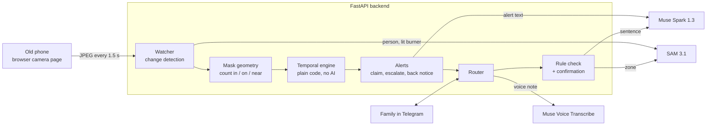

# Kinwatch

**Turn any old phone into a camera your family programs by just telling it, in English, Hindi or Kannada.**
Say what to watch in the family chat, by text or voice note. Kinwatch shows exactly what it understood
on a photo before it starts. When something happens, the whole family gets the alert, sees who is
handling it, and is told when it's over.

▶ **Demo video (3 min):** _link coming_ · Built for the **Meta Global AI Developer Hackathon**
(Indie track, "Build for Your World"), 27 Oct – 4 Nov 2026, with **Muse Spark 1.3, SAM 3.1 and
Muse Voice Transcribe**.

> Kinwatch reports only what the camera saw and when. It never gives medical advice, never
> interprets health, and refuses questions like "Is Papa okay?".

---

## The problem

Millions of Indian families have a parent living alone while the children work in other cities.
The worries are about **moments that unfold over time**: *Papa got up at night and hasn't come back;
the gas is on and nobody is in the kitchen.* Home cameras give you a live feed or a "motion
detected" ping, sent to one person's app. They can't tell you that something *didn't* happen, and
nobody knows who is dealing with an alert.

## What Kinwatch does

| | |
|---|---|
| **Set a rule by talking** | "If Papa gets up from the bed and isn't back in 5 minutes, tell me and Ronny." Typed or a voice note, in English, Hindi, Kannada or Hinglish. |
| **See what it understood** | Before anything is armed, Kinwatch replies with a camera photo and the rule in plain words: *"If Papa leaves the bed and isn't back within 5 minutes, I'll tell Charan and Ronny. Correct?"* Nothing runs until you say yes. |
| **Alert the family, together** | The alert arrives with a photo and an **I've got it** button. The first tap wins and everyone else sees "Ronny is handling it". Nobody answers? It is re-sent, then escalated to the next family member. |
| **Close the loop** | When the situation ends, everyone who was alerted gets *"✅ Papa is back in the bed (6:52 PM, after 9 minutes)"* with a fresh photo. |
| **Ask the camera** | "Is the gas stove on?", "ಸೋಫಾ ಮೇಲೆ ಯಾರಾದರೂ ಇದ್ದಾರಾ?" (is anyone on the sofa?). Answered from the camera right now, with a photo, in the language you asked in. |
| **Each person, their language** | Everyone gets messages in the language they write in. |

**What a rule can say.** Four kinds of rules, combined with a duration, a time window (e.g. "at
night" = 10 PM–6 AM, crossing midnight) and who to tell:

| Kind | Example |
|---|---|
| left and didn't come back | "if Papa leaves the bed and isn't back in 5 minutes" |
| someone is there | "tell me as soon as someone comes to the main door" |
| something is on top of something | "tell me if the cat gets on the bed" |
| nobody is near (optionally: while the flame is on) | "if the gas stove is on and nobody is near it for 1 minute" |

Anything else, including anything about health, gets a polite explanation and the closest rule
Kinwatch *can* run.

## How it works



1. **A rule arrives.** Voice notes go through **Muse Voice Transcribe** (Hindi and Kannada with
   code-switching). Kinwatch echoes what it heard first.
2. **Muse Spark** turns the sentence into a rule as **schema-constrained JSON**: who, which object,
   which of the four conditions, how long, when, and whom to tell. The JSON is then checked in code
   (allowed objects, durations, time windows, names resolved against the family list, health words
   refused).
3. **SAM 3.1** finds the object ("bed", "gas stove") on the latest camera frame. If there are several,
   they are numbered and you pick one ("2", or "no, the other bed", which Muse Spark resolves
   against the numbered photo).
4. **The confirmation is written by code from the checked JSON, not by a model**, so you confirm
   exactly what will run.
5. **Watching.** The phone page uploads a frame every 1.5 s. A free pixel-difference check decides
   when a SAM call is worth it; SAM finds people (and a "lit burner" for stove rules), and NumPy
   mask geometry turns that into a count *in*, *on* or *near* the object.
6. **The temporal engine** is deterministic code: a debouncer (3 agreeing readings over at least
   4 s, so one bad frame can't trigger or reset a rule), a per-rule state machine, time windows
   that cross midnight, one alert per occurrence, and a cooldown. A frame it can't read counts as
   *unknown*, never as a guess.
7. **The alert.** Muse Spark writes it from structured facts only, in each reader's language. Code
   checks every alert (start time present, no invented numbers, no banned medical or emotional
   words, length) and falls back to a fixed template. A background Muse Spark check of three frames
   is logged for review but never holds an alert back.
8. **Claims are atomic** (SQLite serialises writers, so two taps can't both win), and escalation
   deadlines live in the database, so a restart loses nothing.

### How each Meta model is used

| Model | What it does here |
|---|---|
| **Muse Voice Transcribe** | Hindi, Kannada and English voice notes, with code-switching, for rules and questions |
| **Muse Spark 1.3** | Sentence → rule JSON (structured output, low reasoning effort); "no, the other bed" against a numbered photo (vision); question → what to look for; alert writing in en/hi/kn; advisory 3-frame check of each event (vision) |
| **SAM 3.1** | Concept segmentation of the watched object, people and lit burners; masks used as geometry for counting in/on/near; multiple instances numbered so the family can choose |

### The behind-the-scenes page

The bot sends a private link to a page that shows, for each rule: the sentence, Muse Spark's JSON,
the SAM outline, the engine's state and timer, the live camera with outlines, the timeline, and the
API spend. Every timeline entry is labelled with the model (or plain code) that produced it.

## Privacy and safety

- **No health interpretation.** Prompts, code checks on every alert, a banned-terms list in English,
  Hindi and Kannada, and template fallbacks. Health questions are refused.
- **Kinwatch counts people; it never identifies them.** It says so in its confirmations and answers.
- **Frames** are sent to Meta's Model API (Standard mode) and kept only in memory (about the last
  minute). Only alert photos and each rule's confirmation photo are stored, on the laptop running
  Kinwatch.
- **Recording** happens only between `record start` and `record stop`. Takes stay in `data/`
  (gitignored). Sessions kept in the repo have family names swapped for sample names.
- **Secrets and contact details** live only in `.env` and the local database, never in the repo.
- Everyone filmed for the demo agreed to it. The demo is a re-enactment.

## Cost

Every model call goes through a budget guard with hard caps (total, daily, per-minute and per-hour
SAM calls, Spark calls, transcription seconds), a reserve kept for alerts, a circuit breaker and a
kill switch. SAM calls happen only when the picture changed or a heartbeat is due, and never
outside a rule's time window.

**The whole build, including all testing and filming, cost $2.68** of API calls: 963 SAM 3.1
calls ($2.41), 73 Muse Spark calls ($0.27) and 31 transcriptions ($0.01).

## Run it

Needs Python 3.11+.

```bash
python -m venv .venv
.venv/Scripts/activate            # Windows; `source .venv/bin/activate` elsewhere
pip install -r requirements.txt
pytest                            # 388 tests, mock models, network blocked: no credits spent
```

### Mocks only (no API key, no messages)

```bash
cp .env.example .env              # USE_MOCKS=true, MESSENGER=mock
uvicorn backend.main:app          # then GET /healthz
```

### Live, with Telegram and the Meta models

1. Create a bot with [@BotFather](https://t.me/BotFather) and install
   [cloudflared](https://developers.cloudflare.com/cloudflare-one/connections/connect-networks/downloads/)
   (`winget install Cloudflare.cloudflared`) for a free HTTPS tunnel.
2. In `.env`: `USE_MOCKS=false`, `META_API_KEY=…`, `MESSENGER=telegram`, `TELEGRAM_BOT_TOKEN=…`,
   and new values for `DEVICE_TOKEN` and `BTS_TOKEN`.
3. Each family member sends the bot any message; it replies with their Telegram ID. Add them in
   escalation order:
   ```
   FAMILY_MEMBERS_JSON=[{"name":"Priya","channel":"telegram","address":"<id>","is_admin":true},{"name":"Rahul","channel":"telegram","address":"<id>"}]
   ```
4. Run `python scripts/dev_up.py`. It starts the app and the tunnel, points the Telegram webhook at
   it, and sends the admin the **camera link** (open it on the phone that will be the camera and tap
   Start) and the **behind-the-scenes link**.

A WhatsApp Cloud API adapter is also included (`MESSENGER=whatsapp`), but the demo uses Telegram.

### In the chat

| Send | What happens |
|---|---|
| a rule, typed or as a voice note | a photo of what it will watch and the rule in plain words; reply yes to arm it |
| `check` | the latest camera picture |
| `rules` | your rules, numbered, with on/paused |
| `pause 3`, `resume 3`, `delete 3` | change rule 3 (several on separate lines in one message works too) |
| `got it` (or the button) | you're handling the latest alert; the others are told |
| `Is anyone on the sofa?` | an answer from the camera right now, with the photo |
| `record start`, `record stop`, `record list`, `record delete take-2` | record takes to replay (admins) |

An unclaimed alert is re-sent after the claim timeout (2 min; 30 s with `DEMO_MODE=true`), then sent
to the next person in `FAMILY_MEMBERS_JSON`, and closes after three timeouts with a final notice.
Kinwatch also tells the admin if the camera stops sending pictures, or if the phone was turned and
the watched object moved out of view (and again when it finds it).

### Recording and replaying a session

1. Send `record start`, do the run, send `record stop`. The take is saved in `data/sessions/` and
   listed under "Recorded takes" on the behind-the-scenes page, which plays it back with the chat,
   the camera frames and the timeline in sync.
2. Keep good takes in the repo, trimmed, with family names swapped for sample names:
   ```bash
   python scripts/sessions.py list
   python scripts/sessions.py keep take-6 --as bed-demo --from 10 --to 431 --title "Bed: alert, claim and back"
   ```
3. Anyone who clones the repo can play the kept sessions in `fixtures/sessions/`, with no API key
   and no camera:
   ```bash
   MODE=replay uvicorn backend.main:app   # then open http://127.0.0.1:8000/bts
   ```
   Replay mode makes no API calls and refuses to start if `META_API_KEY` is set.

### Check your Meta API key (about $0.02)

```bash
python scripts/live_check.py --spend --voice note.ogg --image photo.jpg --zone bed
```

## Limitations and next steps

- **One camera.** Kinwatch knows only what that camera sees; answers say "in the camera view".
  Several cameras per home is the next step.
- **It counts people and can't tell them apart.** A rule about Papa is really a rule about *someone*
  in the bed; the photo shows the family who it is. This is deliberate (no face recognition).
- **Rules about something that never started** ("tell me if he hasn't come home by 5 PM") aren't
  supported yet; "nobody near the study table for 30 minutes from 6 PM" is the closest today.
- **Gas flames are small.** SAM finds a gas flame as a "lit burner", tested on one stove; a camera
  low and to the side of the burner works best.
- **Low light.** A dark frame counts as "can't see", never as a guess, and the camera answers
  questions with "it's too dark right now"; a small lamp helps.
- **Not on-device.** Frames go to Meta's Model API.
- The Hindi and Kannada wording should get a native speaker's review.

## Built during the hackathon

Everything in this repo was written between 27 Oct and 4 Nov 2026; see the
[commit history](https://github.com/CharanNaidu16/kinwatch/commits/main). Natural-language camera rules exist elsewhere (Nurby,
Cognitive Companion, Alaro). No code was taken from them; Kinwatch's focus is the family chat as the
whole interface, the confirmation photo, and the family claim and escalation. [PLAN.md](PLAN.md) is
the build plan written at kickoff, with notes on what changed.

## License

MIT, see [LICENSE](LICENSE). Dependencies keep their own licenses (`meta_sam_parser`: SAM License).
